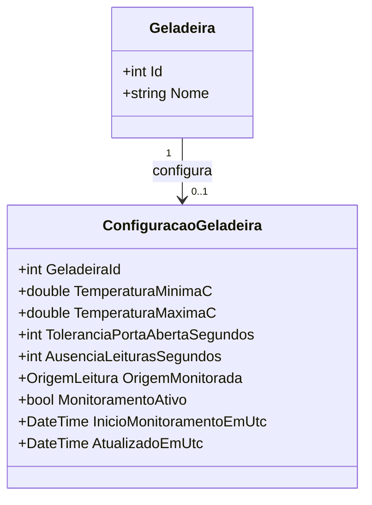

# Configurações de monitoramento por geladeira

Implementação inicial de 09/11/2026, atualizada em 12/11: persistência, API e formulário na página `/configuracoes`. Configurações ativas agora alimentam o [avaliador de alertas](contrato-alertas.md). Os parâmetros não alteram a referência de recência visual nem os dados de medição.

## Contrato HTTP

| Método e rota | Resultado |
| --- | --- |
| `GET /api/geladeiras/{id}/configuracao` | 200 com `{geladeiraId, configuracao}`. `configuracao: null` significa equipamento existente ainda sem parâmetros. Não cria configuração. |
| `PUT /api/geladeiras/{id}/configuracao` | Substitui os seis parâmetros editáveis. Primeira gravação: 201, Location e corpo; atualização: 200 e corpo. |

Geladeira inexistente: 404, inclusive em PUT. Entradas inválidas: 400 com erros de validação. Falha reconhecida de banco/schema: 503 genérico. No acesso remoto, ambas exigem sessão HTTPS; PUT também exige CSRF e origem permitida, como as demais alterações. Não existe POST/DELETE para esta configuração.

Todos os campos abaixo são obrigatórios no PUT, mesmo quando o acompanhamento estiver inativo:

| Campo | Tipo e regra |
| --- | --- |
| `temperaturaMinimaC` | Número JSON finito, estritamente menor que o máximo. |
| `temperaturaMaximaC` | Número JSON finito. |
| `toleranciaPortaAbertaSegundos` | Inteiro JSON de 1 a 2147483647, em segundos. |
| `ausenciaLeiturasSegundos` | Inteiro JSON de 1 a 2147483647, em segundos. |
| `origemMonitorada` | Exatamente `Simulacao` ou `Hardware`. Uma origem monitorada por geladeira nesta versão. |
| `monitoramentoAtivo` | Booleano explícito; omissão e `null` não equivalem a `false`. |

Números em texto são recusados. Não se presume uma faixa sanitária, física ou adequada ao produto armazenado. O limite superior dos tempos decorre do tipo `int`, não de uma recomendação operacional. A interface começa sem limites/tempos preenchidos quando não existe configuração; não há seed.

Exemplo **somente de formato para teste de software**, sem recomendar esses valores para alimentos ou para a geladeira real:

```json
{
  "temperaturaMinimaC": -2.5,
  "temperaturaMaximaC": 5.25,
  "toleranciaPortaAbertaSegundos": 90,
  "ausenciaLeiturasSegundos": 60,
  "origemMonitorada": "Simulacao",
  "monitoramentoAtivo": false
}
```

O corpo de sucesso possui `geladeiraId` e `configuracao`. O objeto interno contém os seis campos acima e `inicioMonitoramentoEmUtc`/`atualizadoEmUtc`. ID e instantes pertencem ao servidor; campos extras enviados para controlá-los são ignorados.

## Semântica temporal e persistência

- Inativo: `inicioMonitoramentoEmUtc` é nulo.
- Ativar: o início e a atualização recebem o mesmo instante UTC do servidor.
- Editar parâmetros enquanto ativo, mantendo a origem: preserva o início; atualiza somente `atualizadoEmUtc`.
- Trocar a origem enquanto ativo ou reativar após pausa: inicia um acompanhamento novo.

Essa referência permite avaliar ausência sem adiar seu prazo ao editar um limite. O avaliador periódico encerra episódios ao desativar/trocar parâmetros e reinicia a confirmação de temperatura/porta pelas novas medições. Os motivos são explícitos, sem atribuir normalização a uma simples desativação. `Hardware` segue como origem declarada; salvar esse campo não autentica um ESP32 nem comprova leitura física.

`ConfiguracoesGeladeiras` tem `GeladeiraId` como PK e FK: no máximo uma configuração por equipamento. A migration `20261109233935_AddConfiguracoesGeladeiras` cria somente essa tabela e suas restrições, sem modificar as duas migrations anteriores, Geladeiras ou Leituras. A configuração é metadado dependente: excluir um equipamento sem leituras remove sua configuração em cascata. A restrição das leituras permanece; excluir um equipamento com histórico retorna 409.

O PUT usa uma transação de escrita curta para serializar consulta e gravação no SQLite. Duas primeiras gravações concorrentes produzem uma criação e uma atualização. Não há controle de versão por operador; a última gravação válida vence. GET usa LEFT JOIN único para distinguir ausência de cadastro de ausência de configuração sem inserir registros.

## Uso e verificação

Inicie normalmente com `scripts/run.ps1` ou, na rede local preparada, `scripts/run-mobile.ps1`. Em Development, migrations pendentes são aplicadas ao iniciar. Preserve backup consistente antes de atualizar; não apague o banco. O SQL atual é `sql/iceplay-criacao-2026-11-12.sql`, somente para banco novo; os SQLs anteriores permanecem históricos.

Na página Configurações, escolha a geladeira, informe os parâmetros/origem/habilitação e salve. Recarregar lê o SQLite pela API. Uma falha de gravação com resultado incerto exige nova consulta antes de permitir outro envio; o cliente não repete o PUT automaticamente.

```powershell
.\scripts\verify-configuracoes.ps1 -EvidenceDirectory docs/evidencias/nova-revisao/configuracoes
node --test scripts/configuracoes.test.mjs
```

O teste HTTP/SQLite usa banco isolado e cobre upgrade com registros prévios, validação, origem/ativação/UTC, concorrência, restrições, persistência em reinício e exclusão. Os testes Node usam DOM/fetch controlados; não substituem Safari/iPhone. Ver `etapa-configuracoes-2026-11-11.md` para resultados reais e pendências da rodada.

O health check existente consulta Geladeiras. Um banco antigo pode responder saudável nessa rota e retornar 503 ao consultar uma tabela de configuração ausente; a implantação deve manter o schema atualizado. A validação física e a definição dos parâmetros reais continuam pendentes.

## Modelo implementado



O diagrama simplifica a assinatura de `InicioMonitoramentoEmUtc`: o código usa `DateTime?`. Relacionamentos de leituras continuam documentados em `contrato-leituras.md`; episódios e checkpoints estão em `contrato-alertas.md`.
