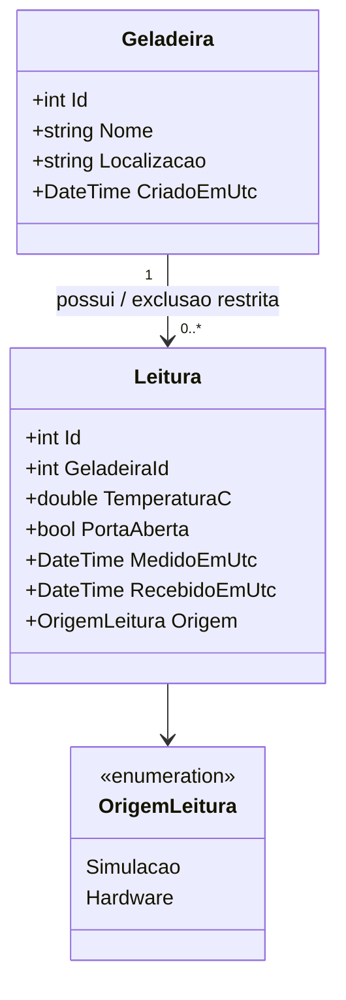
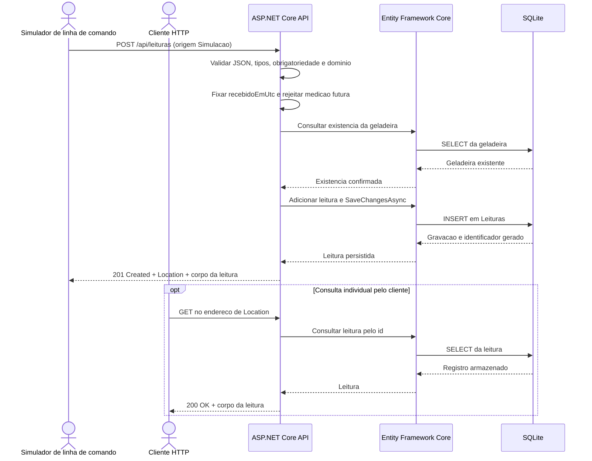

# ICEPLAY — contrato de leituras e modelo atual

Etapa de referência: **17/10/2026**. Este registro descreve o código atual de ingestão, consulta individual e simulador. Os diagramas são fontes Mermaid; este documento não comprova execução, renderização ou ensaio com sensores físicos.

O backend permanece uma única aplicação ASP.NET Core, com Entity Framework Core e SQLite. O simulador envia HTTP para a mesma API prevista para o hardware. A página web gerencia geladeiras, verifica a saúde e, desde a [etapa do painel de 19/10](etapa-painel-2026-10-19.md), apresenta a última leitura por geladeira/origem. Histórico e alertas permanecem futuros. O contrato de ingestão descrito abaixo foi preservado.

## 1. Entrada da API

`POST /api/leituras`, com `Content-Type: application/json`.

Todos os cinco campos abaixo são obrigatórios. Ausência e `null` não substituem valores válidos.

| Campo JSON | Tipo | Regra implementada |
| --- | --- | --- |
| `geladeiraId` | Número JSON inteiro | Entre 1 e 2.147.483.647; deve identificar uma geladeira existente. |
| `temperaturaC` | Número JSON | Deve ser representável como `double` finito. `0`, valores negativos e valores positivos são aceitos. |
| `portaAberta` | Booleano JSON | `true` significa porta aberta; `false` significa porta fechada e é um valor válido. |
| `medidoEmUtc` | String | Data e hora UTC, no formato estrito descrito abaixo. |
| `origem` | String | Exatamente `Simulacao` ou `Hardware`, com essa capitalização. |

Os números usam leitura JSON estrita: `"4"` não substitui `4`, e `"1"` não substitui o identificador numérico `1`. Temperatura com vírgula decimal não é um número JSON válido. `NaN`, infinitos e valores que excedam a representação finita são rejeitados. Para a porta, `"false"`, `0` e `1` não substituem os booleanos JSON. Os tipos anuláveis do DTO permitem distinguir campo ausente de temperatura zero ou porta fechada.

A finitude da temperatura é uma regra de representação numérica. **Não há faixa física de temperatura, limiar de conservação ou regra de alerta implementados nesta etapa.** A aceitação de um número não o torna uma medição plausível, calibrada ou segura para armazenamento de produtos.

`origem` é uma informação **declarada pelo emissor**. `Simulacao` identifica dados de teste. O valor `Hardware` é aceito pelo contrato, mas não comprova conexão com sensor, identidade de dispositivo ou realização de medição física. Não há ESP32 ou sensores físicos disponíveis nem autenticação de dispositivo implementada nesta etapa.

## 2. Instantes e responsabilidade do servidor

`medidoEmUtc` admite exatamente a forma `yyyy-MM-ddTHH:mm:ssZ`, com fração de segundo opcional de **uma a sete casas**. Portanto, são aceitas zero a sete casas no total: sem fração, ou com ponto seguido de 1–7 dígitos. A data e a hora também precisam ser válidas.

Exemplos de formato, sem representar medições executadas:

```text
2026-10-17T12:00:00Z
2026-10-17T12:00:00.1Z
2026-10-17T12:00:00.1234567Z
```

O sufixo `Z` e o separador `T` são obrigatórios. Horário sem segundos, fuso `-03:00`, offset `+00:00`, `z` minúsculo, espaços extras e fração com oito casas não atendem ao contrato.

Na entrada da action, a API fixa `recebidoEmUtc` com `DateTime.UtcNow`, antes de consultar a geladeira e persistir a leitura. Se `medidoEmUtc > recebidoEmUtc`, a requisição retorna `400`. Instantes iguais são aceitos. **Não existe tolerância para futuro neste protótipo**: mesmo uma diferença pequena para frente é rejeitada. Esta regra depende dos relógios do emissor e do servidor; não houve ensaio com relógio de hardware físico. Datas passadas não têm limite de antiguidade definido nesta etapa.

O cliente informa o instante da medição; a API gera o instante de recebimento e o identificador da leitura. `id` e `recebidoEmUtc` não fazem parte do DTO de entrada e não podem determinar os valores persistidos pelo servidor. A resposta contém os dois instantes em UTC. O mapeamento EF recompõe `DateTimeKind.Utc` ao ler as colunas do SQLite.

Exemplo didático de corpo, **não uma medição real nem evidência de envio**. O identificador `1` precisa ser substituído pelo de uma geladeira existente e o instante não pode estar no futuro em relação à API:

```json
{
  "geladeiraId": 1,
  "temperaturaC": 0,
  "portaAberta": false,
  "medidoEmUtc": "2026-10-17T12:00:00Z",
  "origem": "Simulacao"
}
```

## 3. Respostas e consulta individual

| Operação | Status | Significado |
| --- | --- | --- |
| `POST /api/leituras` | `201 Created` | Leitura persistida; corpo com `id`, `geladeiraId`, `temperaturaC`, `portaAberta`, `medidoEmUtc`, `recebidoEmUtc` e `origem`. O cabeçalho `Location` aponta para a consulta individual. |
| `POST /api/leituras` | `400 Bad Request` | JSON, tipos ou campos inválidos, temperatura não finita, origem inválida ou medição posterior ao recebimento. Retorna `ValidationProblemDetails`, com erros de validação. |
| `POST /api/leituras` | `404 Not Found` | A geladeira informada não existe. O controller também trata sua exclusão concorrente antes do `INSERT`. |
| `GET /api/leituras/{id}` | `200 OK` | Retorna a leitura armazenada com os mesmos campos do corpo de criação. |
| `GET /api/leituras/{id}` | `404 Not Found` | Não existe leitura com esse identificador. |
| Ambas as operações | `503 Service Unavailable` | O tratamento central de falhas de banco retorna `ProblemDetails` genérico, sem expor SQL ou mensagem interna da exceção. |

`Location` deve ser usado conforme recebido, sem presumir identificadores ou reconstruir uma resposta fictícia. A consulta individual permite verificar o registro após a criação. Não há endpoint de listagem de leituras, edição ou exclusão de leitura nesta etapa.

Um POST repetido pode gerar outra leitura: não há chave de idempotência ou deduplicação implementada. Perder a resposta não demonstra que o registro deixou de ser salvo; por isso o simulador não repete automaticamente a operação.

## 4. Persistência e preservação de leituras

A migration `20261018023456_AddLeituras` cria apenas a tabela `Leituras`, com suas restrições e o índice composto `(GeladeiraId, MedidoEmUtc, Id)`. Ela não altera a tabela `Geladeiras` nem insere amostras automaticamente.

| Coluna em `Leituras` | Tipo SQLite | Responsabilidade |
| --- | --- | --- |
| `Id` | `INTEGER` | Chave primária gerada pelo banco. |
| `GeladeiraId` | `INTEGER` | Chave estrangeira obrigatória para `Geladeiras.Id`. |
| `TemperaturaC` | `REAL` | Valor numérico finito. |
| `PortaAberta` | `INTEGER` | Booleano persistido como `0` ou `1`. |
| `MedidoEmUtc` | `TEXT` | Instante de medição informado pelo emissor. |
| `RecebidoEmUtc` | `TEXT` | Instante fixado pelo servidor. |
| `Origem` | `TEXT` | Enum convertido para `Simulacao` ou `Hardware`. |

Todas as colunas são obrigatórias. As restrições `CHECK` verificam identificador positivo, domínio da origem, porta em `0/1`, representação finita da temperatura e instantes reconhecidos pelo SQLite, com medição não posterior ao recebimento. Os extremos numéricos do `CHECK` de temperatura são limites de representação de `double`, sem significado de faixa física.

Uma geladeira possui zero ou muitas leituras; cada leitura pertence a exatamente uma geladeira. A chave estrangeira usa `DeleteBehavior.Restrict`, materializado como `ON DELETE RESTRICT`, sem exclusão em cascata.

`DELETE /api/geladeiras/{id}` retorna `409 Conflict` quando há leituras vinculadas, com `ProblemDetails` explicando o vínculo. O cadastro e as leituras são preservados. Sem leituras vinculadas, a exclusão pode retornar `204`; geladeira ausente retorna `404`. Além da consulta prévia, o controller trata a restrição de chave estrangeira se uma leitura for inserida durante a tentativa de exclusão. Uma falha de banco que não corresponda a esse conflito segue o tratamento genérico `503`.

A documentação do SQLite descreve tanto a ativação de chaves estrangeiras por conexão quanto a recusa imediata da ação `RESTRICT` quando existem dependentes. A confirmação da aplicação dessas regras na execução deve usar verificações reais, incluindo o estado de `PRAGMA foreign_keys`; este texto não apresenta resultado dessa consulta. Fonte técnica: [SQLite Foreign Key Support](https://www.sqlite.org/foreignkeys.html).

## 5. Classes do modelo atual



`Localizacao` é `string?` no código. A associação representa a chave estrangeira configurada pelo EF; as classes atuais não declaram propriedades de navegação. Nenhuma entidade de alerta integra este modelo implementado.

## 6. Sequência de ingestão e consulta

O diagrama apresenta o fluxo nominal. As respostas alternativas estão na tabela de status. A consulta por `Location` é uma ação de cliente HTTP separada: o script do simulador faz os POSTs e não executa GET automaticamente.



As validações estão no DTO e na action do mesmo backend, sem serviço ou processo adicional de validação. O fluxo não avalia nem gera alertas.

## 7. Simulador implementado

O script [tools/simulator/enviar-leituras.ps1](../tools/simulator/enviar-leituras.ps1) requer **PowerShell 7.5 ou posterior**. Ele não acessa o SQLite e não representa sensor físico: envia POSTs para `/api/leituras`, exibe aviso de simulação e fixa `origem` em `Simulacao`.

| Parâmetro | Valor padrão | Regra |
| --- | --- | --- |
| `-ApiUrl` | `http://localhost:5080` | URL HTTP/HTTPS absoluta, sem credenciais, consulta ou fragmento. |
| `-GeladeiraId` | Obrigatório | Identificador inteiro positivo de uma geladeira existente. |
| `-Quantidade` | `1` | Inteiro entre 1 e 1.000. |
| `-IntervaloSegundos` | `1` | Número finito entre 0 e 3.600; espera entre os envios. |
| `-TemperaturaC` | `4` | Número finito de teste; permanece igual nos envios da mesma execução. |
| `-PortaAberta` | Ausente: `false` | Switch; quando informado, envia `true`. |

Cada envio recebe um novo `medidoEmUtc` obtido de `DateTime.UtcNow`, formatado com `o`, em UTC. O timeout HTTP do script é de **10 segundos**. Resposta diferente de `201`, JSON inválido ou confirmação com origem/geladeira/identificador incompatíveis interrompem a execução. Falha sem resposta confirmada também interrompe o script e informa a possibilidade de gravação. Não existe repetição automática.

Exemplo de uso, sem alegação de execução. O identificador `1` é apenas um exemplo e deve corresponder a um cadastro existente:

```powershell
pwsh -NoProfile -File .\tools\simulator\enviar-leituras.ps1 -GeladeiraId 1 -Quantidade 3 -TemperaturaC 4 -IntervaloSegundos 1
```

Para simular porta aberta, acrescente `-PortaAberta`. O script não alterna automaticamente porta ou temperatura.

Para cada envio confirmado, a saída é um objeto PowerShell que envolve a resposta da API:

| Propriedade de saída | Conteúdo |
| --- | --- |
| `indice` | Posição do envio na execução, começando em 1. |
| `statusHttp` | Status HTTP recebido, validado como `201`. |
| `location` | Cabeçalho `Location` recebido da API. |
| `leitura` | Corpo JSON da resposta convertido em objeto, incluindo origem, identificador e instantes. |

Esse objeto de saída não é outro contrato de entrada da API. Seus valores são os retornados durante a execução; este documento não os substitui por resultados fabricados.

## 8. Rastreabilidade e fontes técnicas

O registro foi elaborado a partir dos arquivos atuais:

- [CriarLeituraRequest.cs](../src/Iceplay.Api/Contracts/CriarLeituraRequest.cs) e [LeituraResponse.cs](../src/Iceplay.Api/Contracts/LeituraResponse.cs): campos e validação.
- [LeiturasController.cs](../src/Iceplay.Api/Controllers/LeiturasController.cs): recebimento, persistência e consulta por ID.
- [Leitura.cs](../src/Iceplay.Api/Models/Leitura.cs), [OrigemLeitura.cs](../src/Iceplay.Api/Models/OrigemLeitura.cs) e [IceplayDbContext.cs](../src/Iceplay.Api/Data/IceplayDbContext.cs): domínio e mapeamento.
- [20261018023456_AddLeituras.cs](../src/Iceplay.Api/Migrations/20261018023456_AddLeituras.cs): tabela, restrições e índice.
- [GeladeirasController.cs](../src/Iceplay.Api/Controllers/GeladeirasController.cs) e [DatabaseExceptionHandler.cs](../src/Iceplay.Api/Data/DatabaseExceptionHandler.cs): preservação do histórico e respostas de falha.
- [enviar-leituras.ps1](../tools/simulator/enviar-leituras.ps1): emissor de simulação e objeto de saída.

A documentação técnica consultada do [provedor SQLite do EF Core — limitações](https://learn.microsoft.com/en-us/ef/core/providers/sqlite/limitations) orienta o uso de `DateTime` com normalização UTC e descreve limitações de tipos e migrations. O projeto usa `DateTime` UTC e `double`; as regras concretas deste contrato são as do código citado. A referência de [chaves estrangeiras do SQLite](https://www.sqlite.org/foreignkeys.html) fundamenta a explicação de integridade referencial e `RESTRICT`.

Essas fontes são documentação técnica, não referências científicas ou resultados experimentais. Aprovação em build, testes de API, persistência, simulador e inspeção visual deve ser registrada separadamente com seus resultados reais. Os [diagramas de 13/10/2026](uml.md) permanecem como histórico da proposta inicial.
