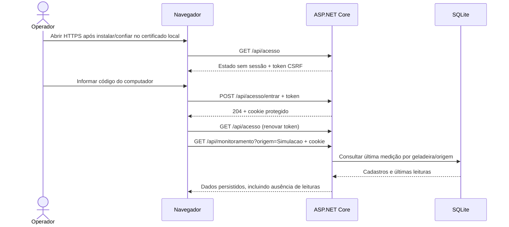

# Etapa móvel — 19/10/2026

## Decisão e escopo

O aluno pediu prosseguir com o projeto para uso pelo celular e informou que testará em **iPhone, no mesmo Wi-Fi**. Foram inspecionados código, scripts, configurações e rede antes das mudanças. A aplicação escutava somente em loopback e `AllowedHosts` aceitava apenas localhost/127.0.0.1. O computador possui Ethernet `192.168.1.123/24`, perfil Público; a conta desta sessão não é administradora.

Foi acrescentado um modo opcional de desenvolvimento na rede local: HTTPS no IPv4 específico, código compartilhado de operador e cookie de sessão. A preparação do iPhone usa uma porta HTTP separada que disponibiliza **somente instruções e certificado público**, bloqueando a API. Essa escolha preserva ASP.NET Core/EF Core/SQLite/HTML/CSS/JS e evita transmitir código e operações da API em HTTP pela rede. Não houve pacote, migration, tabela de usuário, seed, PWA, histórico ou alerta novo.

O modo comum permanece em localhost. Mesmo que alguém sobrescreva a URL para escutar fora do loopback com o modo móvel desligado, o middleware rejeita clientes remotos. O modo móvel limita clientes à sub-rede IPv4 privada configurada, usa hosts explícitos e mantém o banco existente.

## Fluxo implementado

- `GET /api/acesso`: informa modo, necessidade de conexão, estado da sessão e token CSRF quando necessário. Resposta sem cache.
- `POST /api/acesso/entrar`: recebe `{"codigo":"código guardado no computador"}`, exige HTTPS e token CSRF; sucesso 204, código incorreto 401, formulário inválido 400, limite de tentativas 429.
- `POST /api/acesso/sair`: exige sessão/CSRF no acesso móvel e retorna 204.
- APIs existentes na rede exigem sessão; acesso sem sessão retorna 401. Mutações exigem token CSRF e recusam uma origem explicitamente diferente da aplicação com 403.
- Cookie de sessão Secure/HttpOnly/SameSite Strict, duração máxima de 8 horas, sem renovação automática. Chaves de proteção efêmeras invalidam sessões após reinício. O loopback HTTP na porta local é o canal do operador no computador; não exige código.
- Limite global de oito tentativas de entrada por minuto por instância. Código aleatório de 256 bits, comparado em tempo constante; arquivos privados ficam em `.tools/mobile` com permissões da conta local e fora do Git. Código não é colocado em URL ou armazenamento JavaScript.
- A interface solicita conexão somente no acesso móvel HTTPS, renova o token após login, permite saída, não repete gravações automaticamente e descarta respostas de consultas anteriores a uma mudança de acesso. Falhas de autenticação deixam a saúde como não consultada, sem afirmar falha do SQLite.
- Em telas pequenas, atalhos inferiores, área reservada para a barra/área segura, campos com 16 px e ações principais com pelo menos 44 px. O painel continua exibindo somente dados consultados e a referência de recência de 60 segundos.



Este é o fluxo de software implementado; a primeira ação no aparelho ainda requer execução pelo aluno. A fonte Mermaid não é apresentada como exportação PlantUML ou teste no Safari.

## Arquivos

| Arquivos | Responsabilidade |
| --- | --- |
| `src/Iceplay.Api/Program.cs` | Carregamento opcional da configuração privada e integração dos middlewares |
| `src/Iceplay.Api/Mobile/MobileAccessSettings.cs` | Validação da configuração, rede e código |
| `src/Iceplay.Api/Mobile/MobileAccessExtensions.cs` | HTTPS, cookies, CSRF e limite de tentativas com recursos nativos |
| `src/Iceplay.Api/Mobile/MobileAccessMiddleware.cs` | Restrições de acesso, certificado público, sessão e alterações |
| `src/Iceplay.Api/Controllers/AcessoController.cs` | Estado de acesso, entrada e saída |
| `src/Iceplay.Api/wwwroot/acesso.js` | Conexão do dispositivo e requisições com sessão/CSRF |
| `wwwroot/index.html`, `styles.css`, `app.js`, `geladeiras.js`, `monitoramento.js` | Formulário, navegação móvel e integração das consultas existentes |
| `scripts/prepare-mobile.ps1`, `run-mobile.ps1`, `mobile-firewall.ps1` | Preparação, execução e regra de firewall específica |
| `scripts/verify-mobile.ps1`, `verify-mobile.py`, `acesso.test.mjs` | Verificação isolada TLS/HTTP/SQLite e testes do cliente |
| README, roteiro do iPhone, este relatório, cronograma, UML e uso de IA | Instruções e situação real |
| `docs/evidencias/2026-10-19-mobile/` | Logs, relatórios, tentativas e captura de viewport |

## Verificação executada

| Verificação | Resultado real |
| --- | --- |
| Build | 0 avisos e 0 erros — `build.log` |
| Integração móvel | **82 asserções / 61 requisições registradas**, além do envio do simulador — `mobile-api.json` |
| Cliente de acesso | **8 testes aprovados** — `acesso-js.log`; DOM/fetch controlados em Node, não navegador real |
| Recência e contrato do painel | **12 testes aprovados** — `monitoramento-estado.log` |
| Regressão da base | **13 verificações aprovadas** — `base/smoke-latest.json` |
| Regressão do cadastro | **807 asserções / 177 requisições** — `cadastro/crud-api.json` |
| Regressão das leituras | **339 asserções / 75 requisições** — `leituras/leituras-api.json` |
| Regressão do painel | **70 asserções / 29 requisições**, além do simulador — `painel/monitoramento-api.json` |
| Navegador de desenvolvimento | **9 verificações registradas** — `browser.json`, em HTTP loopback e cópia SQLite isolada |
| Preservação | **176 arquivos protegidos sem diferenças SHA-256** — `preservacao.json` |
| Banco de uso e execução móvel normal | Saúde local e HTTPS autenticada em 200; uma geladeira, nenhuma leitura e conteúdo lógico preservado — `execucao-normal.json` |

As asserções não são cenários independentes nem uma porcentagem de cobertura. Os testes de integração móvel usam conexões reais ao IP privado, verificam certificado/hostname confiando explicitamente na CA de teste, cookies, CSRF, bloqueios, CRUD, simulador, SQLite e reinício. Também verificam a rejeição do hostname incorreto, CA não confiada, API na porta HTTP do certificado e cliente remoto com modo móvel desligado. Não foi usado bypass de validação TLS.

O banco da integração termina com **uma geladeira e duas leituras fixture**. Para a interface foi criada uma cópia consistente, preservando esse resultado e o banco normal. A UI foi verificada em 320, 390, 844×390 e 1280 pixels; cadastro/edição/exclusão de uma fixture sem leituras foram realmente executados na tela pequena. A captura `interface-390.png` mostra simulação em banco isolado. O login HTTPS foi verificado pela API e por testes de cliente com DOM controlado; **não foi exercitado no Safari/iPhone nem em navegador com o certificado instalado**.

Falhas encontradas e corrigidas: a primeira tentativa TLS rejeitou o certificado por falta de Authority Key Identifier; a geração foi corrigida sem reduzir a validação e o resultado inicial preservado em `attempt-1`. A segunda tentativa passou pelo login/CRUD, mas o coletor do simulador falhou ao decodificar saída do PowerShell; a captura foi corrigida e `attempt-2` preservado. Também foram corrigidas a atualização de permissões da pasta sem exigir privilégio de auditoria e a leitura de validade ISO sem conversão automática dependente da cultura. A preparação foi repetida com sucesso preservando o certificado/código, conforme `preparacao-idempotente.json`.

Comandos principais efetivamente executados:

```powershell
.\scripts\prepare-mobile.ps1 -EnderecoIp 192.168.1.123
# A geração inicial foi corrigida e renovada antes de qualquer instalação no aparelho:
.\scripts\prepare-mobile.ps1 -EnderecoIp 192.168.1.123 -RenovarCertificado
.\scripts\verify-mobile.ps1 -EnderecoIp 192.168.1.123 -EvidenceDirectory docs/evidencias/2026-10-19-mobile
.\scripts\verify.ps1 -EvidenceDirectory docs/evidencias/2026-10-19-mobile/base
.\scripts\verify-geladeiras.ps1 -EvidenceDirectory docs/evidencias/2026-10-19-mobile/cadastro
.\scripts\verify-leituras.ps1 -EvidenceDirectory docs/evidencias/2026-10-19-mobile/leituras
.\scripts\verify-monitoramento.ps1 -EvidenceDirectory docs/evidencias/2026-10-19-mobile/painel
node --test scripts/acesso.test.mjs
node --test scripts/monitoramento-estado.test.mjs
```

Os verificadores compilam com `dotnet build Iceplay.slnx --no-restore` pelo SDK local. Também foram inspecionados rede/perfis/portas, privilégios, sintaxe, relatórios e hashes; foram feitos testes de viewport/CRUD no navegador e backup SQLite consistente para a cópia de UI. A preservação das fontes protegidas e do conteúdo do banco de uso é registrada em `preservacao.json` e `execucao-normal.json` desta pasta de evidências.

A instância de UI foi encerrada e `run-mobile.ps1` foi executado com a conexão normal, sem sobrescrever o banco. Foram consultadas saúde local, saúde HTTPS após login real, painel nas duas origens e saída, sem mutação de cadastro/leituras. Uma inspeção SQLite somente leitura antes/depois confirmou uma geladeira, nenhuma leitura, duas migrations, integridade e o mesmo SHA-256 das linhas. A busca pelos dez valores de credenciais gerados na sessão não encontrou ocorrências nos 272 arquivos textuais examinados fora de `.tools`, conforme `segredos.json`; isso não é uma auditoria de segurança completa. A conferência de sintaxe e whitespace está em `sintaxe.json`.

O `git diff --check` das fontes, scripts, Markdown e JSON passou. O check amplo inicialmente apontou finais de linha da saída bruta do simulador; os `.log` foram preservados e excluídos do escopo de lint, sem atribuir essa formatação a um defeito da aplicação. Não houve commit ou publicação.

## Pendências e conclusão limitada

O script de firewall **não foi aplicado**: exige PowerShell administrador e esta sessão não possui esse privilégio. Nenhum perfil de rede ou certificado confiável do sistema/aparelho foi alterado automaticamente. Não se afirma alcance entre dois aparelhos com base em uma conexão do próprio computador ao seu IPv4.

O [roteiro do iPhone](acesso-iphone.md) contém as ações finais: liberar somente as duas portas, instalar/conferir/confiar na CA local, abrir HTTPS e testar consulta/cadastro/monitoramento no Safari. O aparelho é necessário para concluir a validação de teclado, área segura, comportamento real do Safari e comunicação pela rede. A biblioteca de cookies do teste Python não valida por si só o comportamento de SameSite de um navegador.

Código compartilhado de operador local não é identidade individual, autorização por perfis ou autenticação do ESP32. O HTTP loopback continua sendo o canal confiável do operador local. Acesso pela internet e implantação pública exigem projeto próprio; não foram configurados encaminhamento de portas, serviços externos, PWA ou notificações. Histórico/limites/alertas continuam fora desta mudança. Nenhum commit ou publicação foi realizado.

Fontes técnicas consultadas: [Kestrel/endpoints](https://learn.microsoft.com/en-us/aspnet/core/fundamentals/servers/kestrel/endpoints?view=aspnetcore-10.0), [cookies ASP.NET Core](https://learn.microsoft.com/en-us/aspnet/core/security/authentication/cookie?view=aspnetcore-10.0), [antiforgery](https://learn.microsoft.com/en-us/aspnet/core/security/anti-request-forgery?view=aspnetcore-10.0), [regra específica do firewall](https://learn.microsoft.com/en-us/powershell/module/netsecurity/new-netfirewallrule?view=windowsserver2025-ps), [perfil no iPhone](https://support.apple.com/pt-br/102400) e [confiança TLS no iPhone](https://support.apple.com/pt-br/102390). Não são referências científicas inventadas nem evidência de experimento físico.
