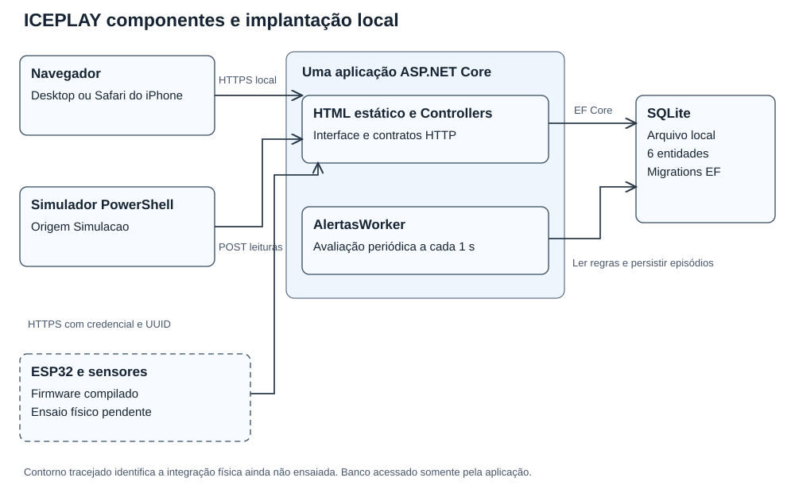
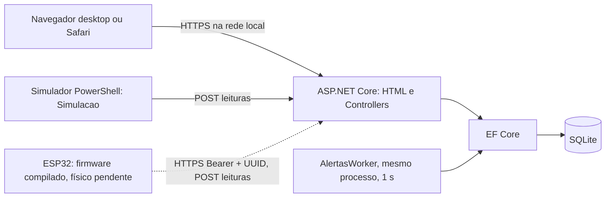
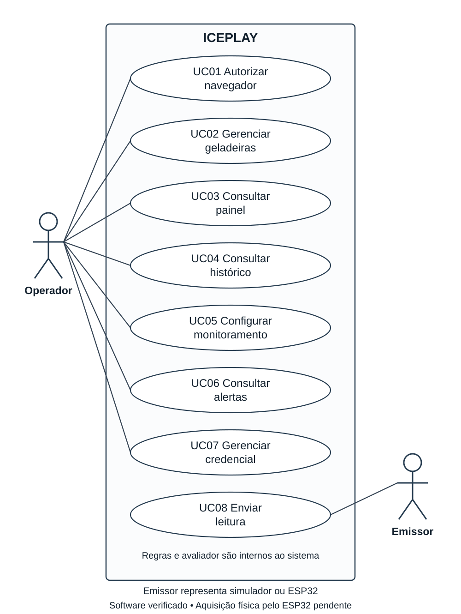
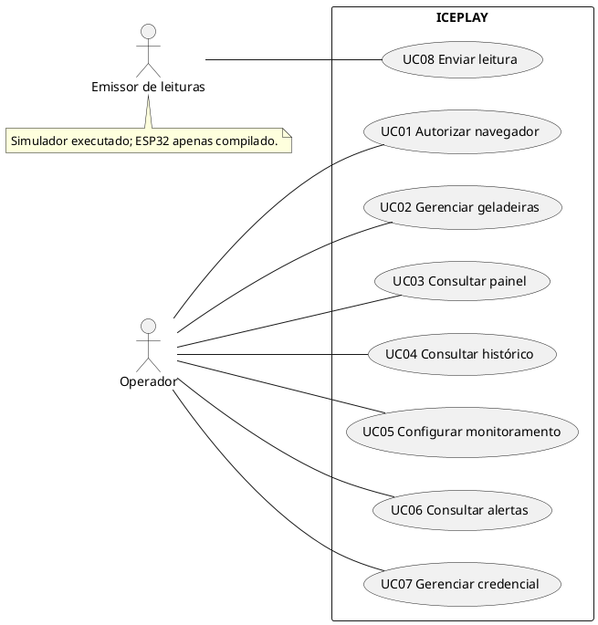
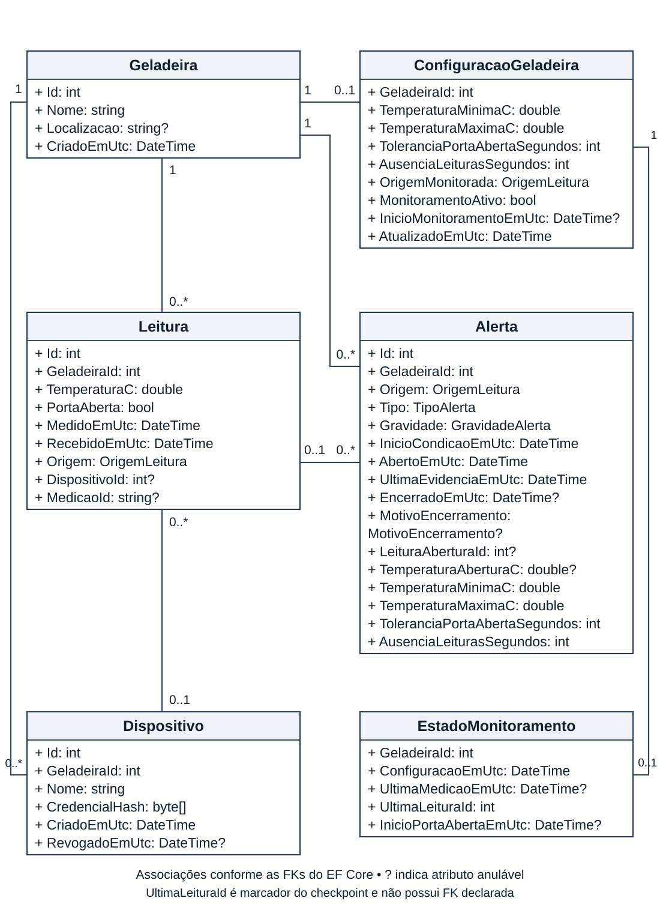
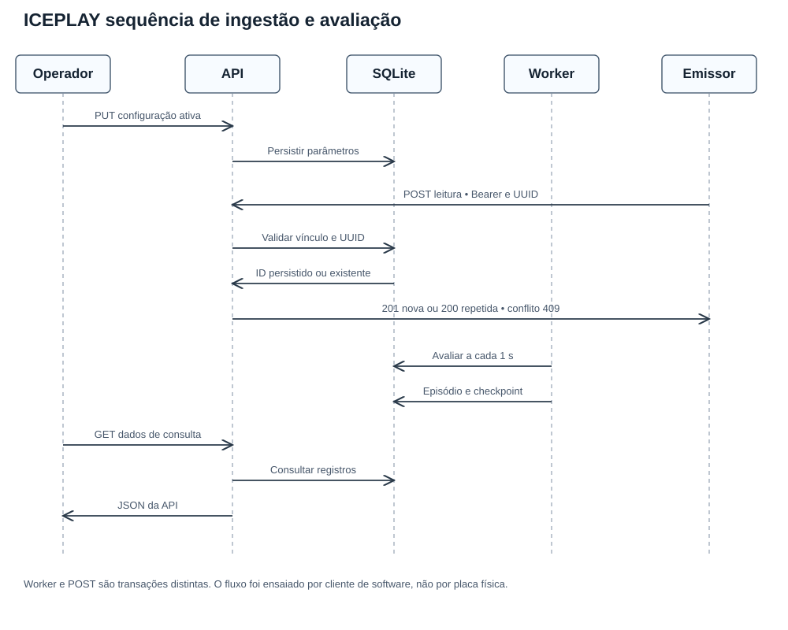
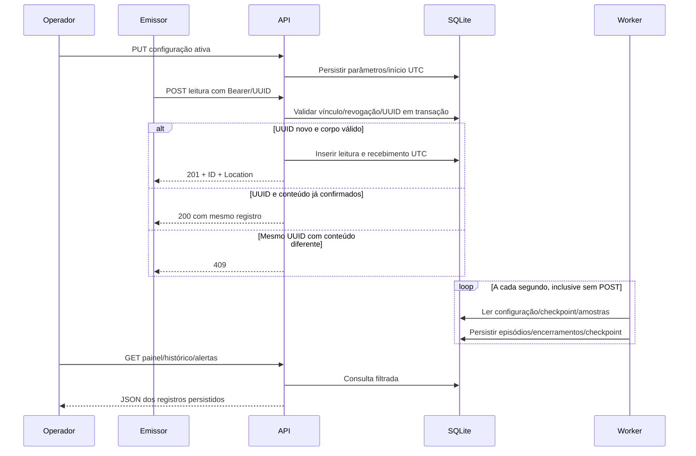
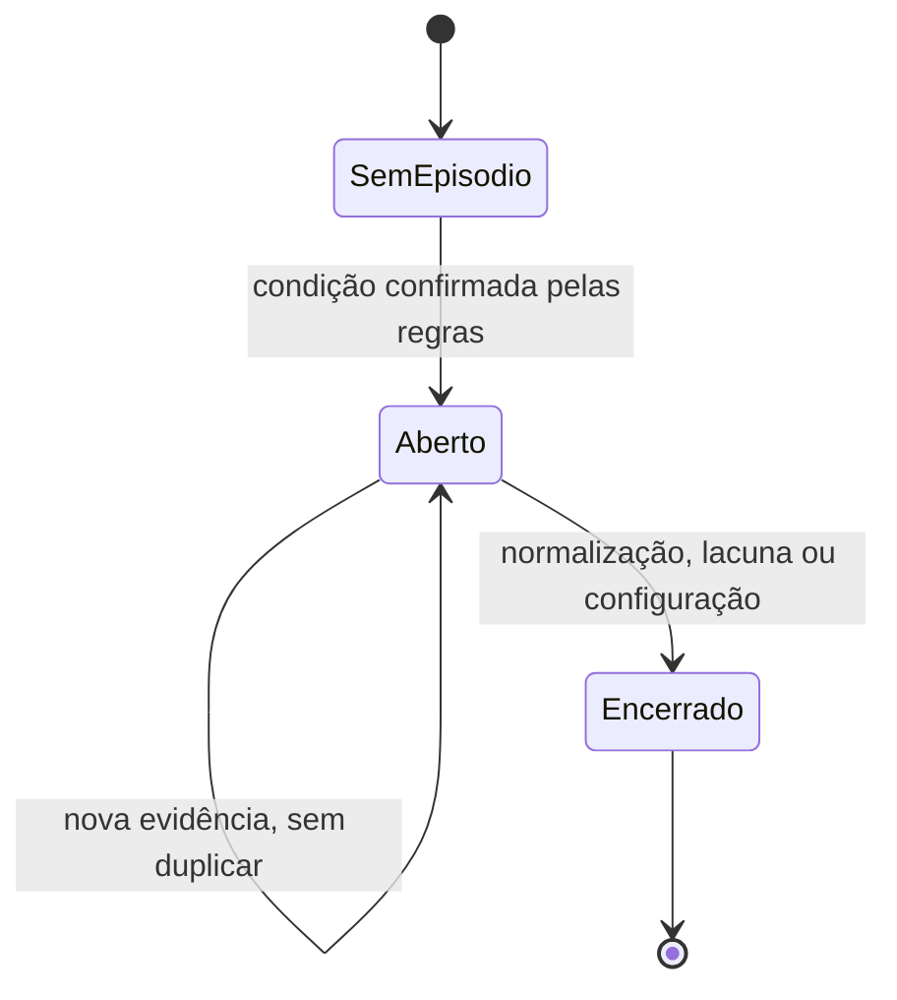

# Modelagem consolidada do ICEPLAY

Modelo do código, revisado em 17/11/2026 contra a versão `98dabcc`. `uml.md` e as figuras de `diagramas/` permanecem como versões históricas. Os diagramas descrevem software atual; o nó físico está preparado em firmware, sem ensaio de sensores executado. O reconhecimento USB de 16/11 é parcial. O [complemento editável](tcc/materiais-modelagem-2026-11-17/README.md) contém os requisitos, oito casos de uso detalhados, classes completas, figuras e rastreabilidade dos testes. As figuras são modelos, não capturas de execução.

## Componentes e implantação prevista

Existe um processo de API, não um serviço separado para cada caixa lógica. O browser consulta a API; não acessa o banco. O dispositivo usa credencial limitada à ingestão; o operador gerencia configurações/credenciais.

## Casos de uso

Fonte: código e requisitos do ICEPLAY, com assistência de IA, 17/11/2026. O limite deste modelo é a aplicação ICEPLAY: Operador e Emissor de leituras são papéis externos; relógio, worker e SQLite são internos. Por isso, o relógio não é ator nesta revisão. O emissor pode ser o simulador ou o futuro ESP32; o envio físico continua pendente. Não foram adicionados casos de uso fictícios de login por usuário/senha ou encerramento manual de alertas.

Fonte editável em [PlantUML](tcc/materiais-modelagem-2026-11-17/figuras/casos-de-uso.puml). O SVG/PNG foi desenhado a partir do mesmo catálogo, sem executar um renderizador PlantUML nesta entrega:

Os oito casos estão [especificados com pré-condições, fluxo, alternativas, pós-condições e testes](tcc/materiais-modelagem-2026-11-17/modelagem-validacao.md#5-casos-de-uso). Enviar leitura exige geladeira e contrato válidos; com credencial, equipamento/origem autorizados. Consultar histórico exige equipamento/origem; alterar parâmetros exige entradas válidas e sessão/CSRF no acesso móvel protegido. A avaliação assíncrona das regras é detalhada na sequência abaixo.

## Classes e cardinalidades

Fonte: Models e IceplayDbContext do ICEPLAY, com assistência de IA, 17/11/2026. O diagrama apresenta as seis entidades, todos os 49 atributos públicos e as sete associações efetivamente mapeadas no EF Core. `?` indica atributo anulável em C#. Não foram inventados métodos nas entidades: operações são implementadas em controllers e serviços.

O [dicionário completo e as multiplicidades/regras de exclusão](tcc/materiais-modelagem-2026-11-17/modelagem-validacao.md#6-classes-e-persistência), o [modelo JSON](tcc/materiais-modelagem-2026-11-17/modelo-classes.json) e a [fonte PlantUML](tcc/materiais-modelagem-2026-11-17/figuras/classes.puml) permitem conferir a figura. `UltimaLeituraId` do checkpoint é marcador e **não possui FK declarada**. Leituras legadas podem não ter dispositivo/UUID; o vínculo da leitura de abertura de alerta também é opcional. Não há tabela separada para enumerações. As figuras antigas foram preservadas como histórico e a versão completa acima é a referência para o TCC atual.

## Sequência de ingestão e avaliação

O fluxo do emissor foi exercitado por cliente de software autenticado. Não representa uma sequência capturada de ESP32 real. POST e ciclo do worker são transações distintas; alertas têm atualização assíncrona.

## Estados de um episódio

Novo desvio após encerramento cria outro episódio. O histórico não é apagado. Ausência de medições e mudança/desativação possuem motivos próprios; nenhum desses motivos confirma temperatura normal.
