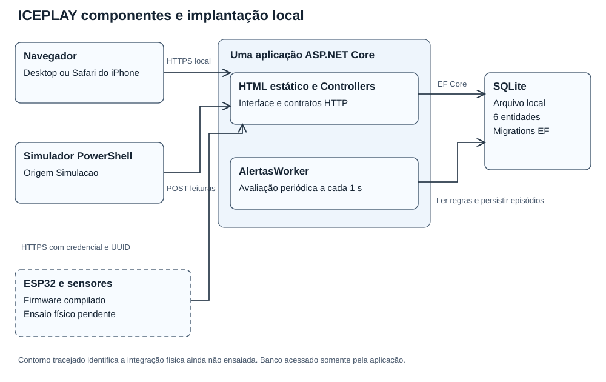
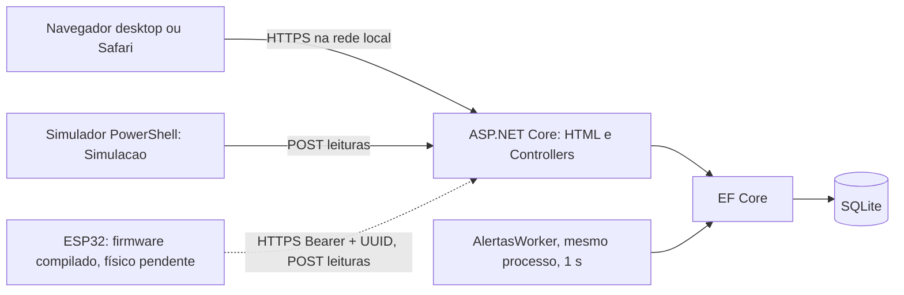
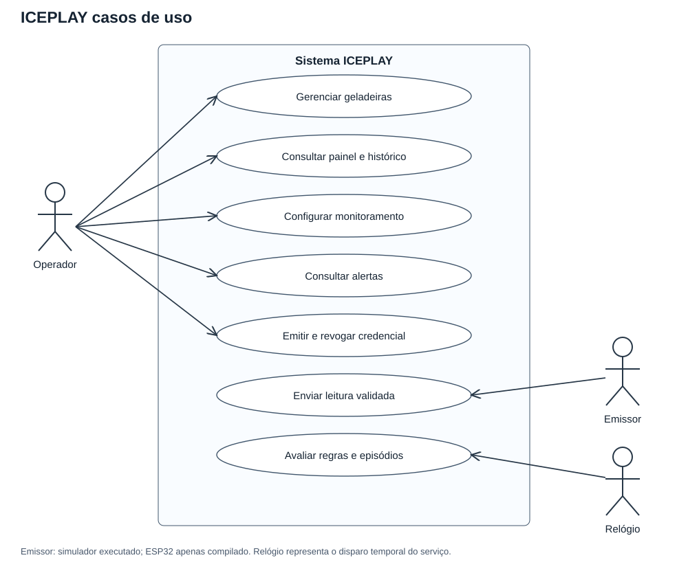
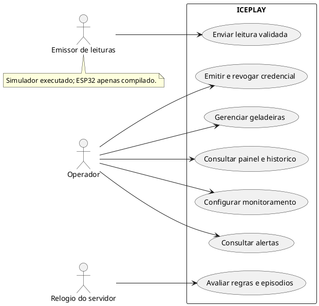
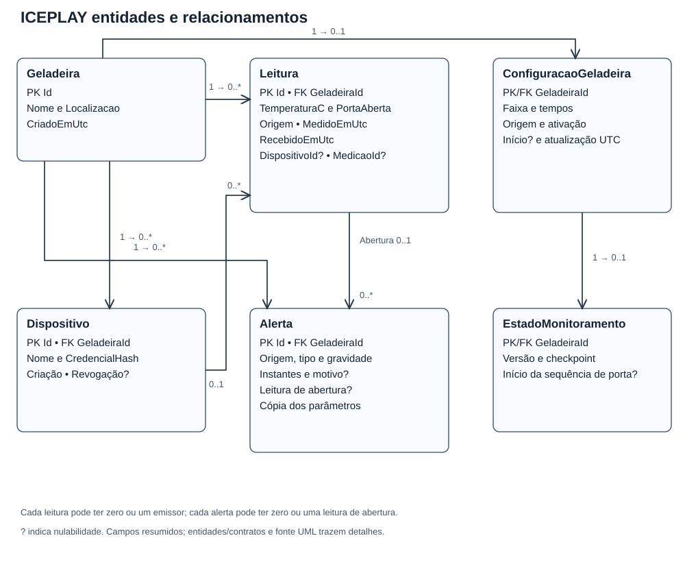
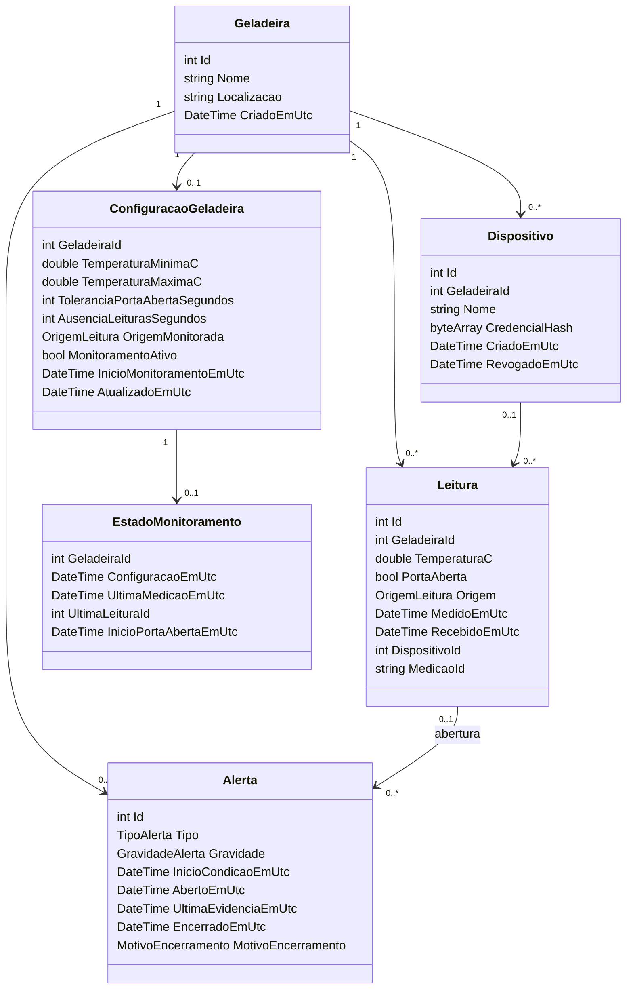
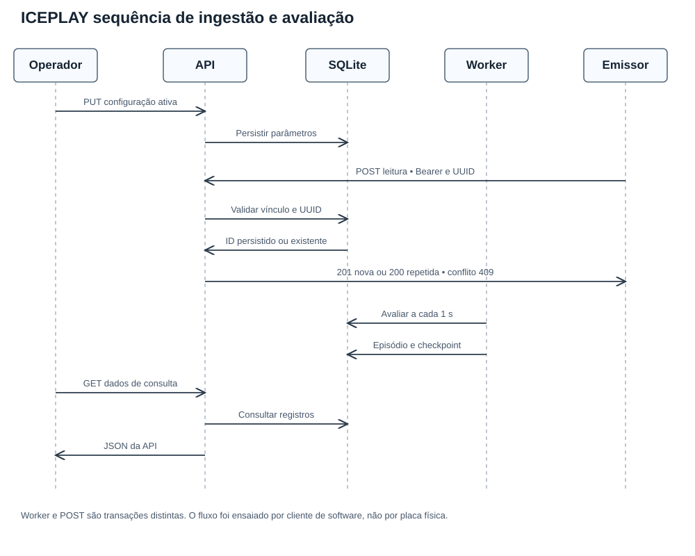
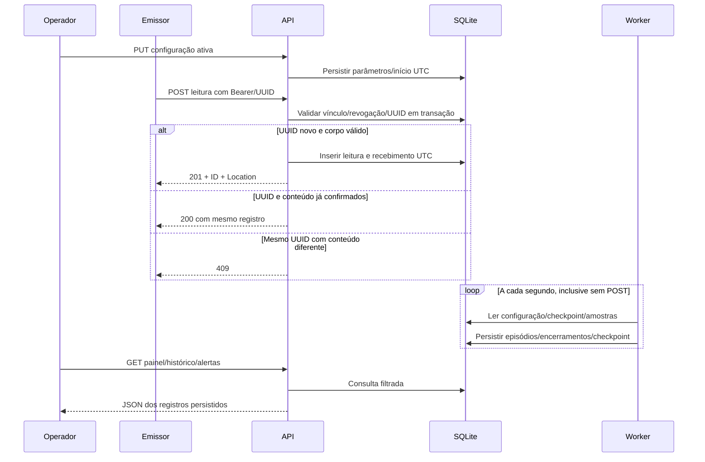
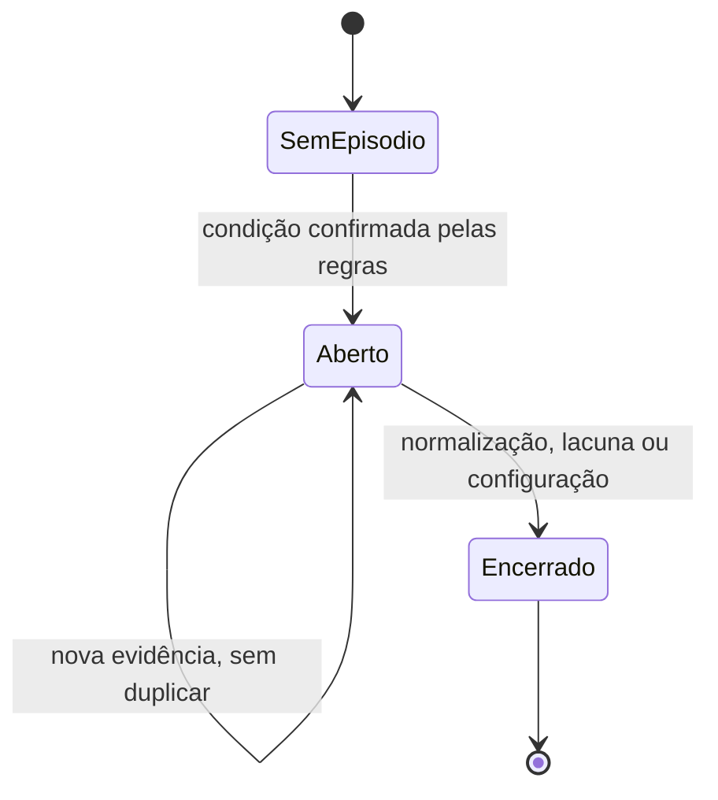

# Modelagem consolidada do ICEPLAY

Modelo do código de 13/11/2026. `uml.md` permanece como versão histórica da base inicial. Os diagramas abaixo descrevem software atual; o nó físico está preparado em firmware, sem ensaio executado. As figuras SVG complementares ficam em `diagramas/` e não são capturas do sistema.

## Componentes e implantação prevista

Existe um processo de API, não um serviço separado para cada caixa lógica. O browser consulta a API; não acessa o banco. O dispositivo usa credencial limitada à ingestão; o operador gerencia configurações/credenciais.

## Casos de uso

Fonte PlantUML atual, com ator físico ainda pendente de validação:

Enviar leitura tem pré-condição de geladeira existente e contrato válido. Com credencial, deve corresponder ao equipamento/origem autorizados. Consultar histórico exige equipamento/origem; alterar parâmetros exige entradas válidas e sessão/CSRF no acesso remoto. Não existe caso de uso de normalizar alerta manualmente: o motivo vem das regras.

## Classes e cardinalidades

O desenho simplifica nulabilidade: Localizacao, DispositivoId/MedicaoId, início de acompanhamento inativo, instantes opcionais de estado e encerramento/revogação são anuláveis no código. Alerta também guarda FK/origem, leitura/temperatura de abertura e cópia dos quatro parâmetros; ver entidade/contrato completos. Não há tabela separada para enumerações.

## Sequência de ingestão e avaliação

O fluxo do emissor foi exercitado por cliente de software autenticado. Não representa uma sequência capturada de ESP32 real. POST e ciclo do worker são transações distintas; alertas têm atualização assíncrona.

## Estados de um episódio

Novo desvio após encerramento cria outro episódio. O histórico não é apagado. Ausência de medições e mudança/desativação possuem motivos próprios; nenhum desses motivos confirma temperatura normal.
