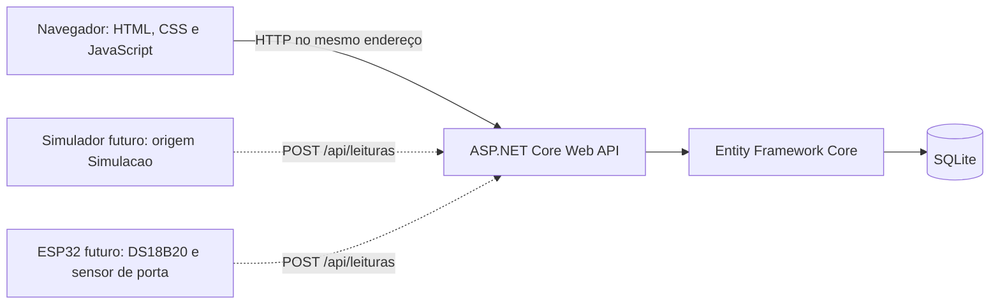

# ICEPLAY — planejamento técnico

Data de referência: **13/10/2026**. Entrega e apresentação informadas pelo aluno: **01/12/2026**.

**Atualização em 19/10/2026:** o cronograma do professor foi fornecido nesta data. O [cronograma oficial e plano de execução](cronograma-oficial.md) passa a orientar as próximas entregas e substitui a proposta da seção 9 abaixo. Este documento permanece como registro da análise inicial; seus itens descritos como futuros não representam automaticamente a situação atual. A versão completa é exigida em **24/11**, com apresentação em **01/12**.

Este documento registra decisões de arquitetura, requisitos e a proposta incremental original. Em 13/10, o cronograma detalhado do professor ainda não havia sido fornecido. Funcionalidades planejadas não constituem código implementado, medições ou resultados experimentais.

## 1. Situação inicial e escopo desta entrega

A inspeção inicial da pasta de trabalho encontrou uma pasta vazia, sem código existente. O aluno informou que não dispõe de ESP32 nem sensores físicos. Os resultados da inspeção de ferramentas e os testes de execução devem ser registrados em `docs/evidencias`; este planejamento não substitui esses registros.

| Item | Escopo de 13/10/2026 | Evolução posterior |
| --- | --- | --- |
| Backend | ASP.NET Core executável | Cadastro, ingestão, histórico e alertas |
| Banco | EF Core, SQLite e migration inicial de `Geladeira` | `Leitura`, `Alerta`, configurações e índices |
| API | `GET /api/health`, consultando a tabela de geladeiras | Endpoints de negócio descritos adiante |
| Interface | Página inicial navegável e estado de saúde real | Painel com dados e histórico |
| Sensores | Nenhuma leitura inserida como medição real | Simulador identificado e futura integração física |
| Verificação | Build, execução HTTP e consulta ao banco registrados | Testes das regras e cenários de demonstração |
| Documentação | README, planejamento e fontes dos diagramas | TCC, artigo e documentação atualizados semanalmente |

O escopo da primeira coluna é a base desta etapa. A implementação e sua aprovação devem ser comprovadas pelos arquivos e registros reais de execução. Esta etapa não contém CRUD de geladeiras, leituras, alertas, simulador, firmware ou notificações.

## 2. Arquitetura escolhida

Será usada uma aplicação ASP.NET Core Web API que também hospeda os arquivos estáticos do frontend. O Entity Framework Core traduz as operações das entidades para o SQLite. Um único processo local e um arquivo de banco atendem à base acadêmica inicial.



As linhas pontilhadas são componentes futuros. Na primeira entrega, somente o navegador, a aplicação e o SQLite entram na demonstração.

### Responsabilidades

- **Controllers:** recebem requisições HTTP, validam o contrato e escolhem respostas HTTP.
- **Models:** representam os dados persistidos e suas relações.
- **Data:** contém o `DbContext` e a configuração do armazenamento. O contexto acompanha entidades e executa consultas e alterações no banco.
- **Migrations:** registram, em código versionável, as mudanças do esquema. Permitem evoluir o banco sem recriá-lo a cada alteração.
- **wwwroot:** contém HTML, CSS e JavaScript enviados ao navegador. O frontend consulta a API do mesmo endereço.
- **Services, futuramente:** concentrarão regras de alertas e processamento temporal quando essas regras existirem. Não é necessário criar camadas vazias agora.

Não há necessidade inicial de microserviços, broker de mensagens, framework JavaScript, contêiner, banco remoto ou biblioteca de gráficos. Se aparecer uma necessidade comprovada, a mudança deve ser justificada e registrada antes da implementação.

### Versões e decisões de armazenamento

As versões selecionadas para a base são SDK **.NET 10.0.401**, EF Core SQLite e Design **10.0.12** e ferramenta local `dotnet-ef` **10.0.12**. O registro de ambiente deve distinguir a versão escolhida da versão efetivamente instalada e executada.

O .NET 10 é uma versão LTS com suporte previsto até 14/11/2028. A política oficial consultada lista o término de suporte de .NET 8 e .NET 9 em 10/11/2026, antes da apresentação. Isso fundamenta a escolha de .NET 10 para a entrega de dezembro. A política também exige acompanhar atualizações de correção durante o suporte. [Política oficial de suporte do .NET](https://dotnet.microsoft.com/en-us/platform/support/policy/dotnet-core).

Serão geradas migrations reais com EF Core. A aplicação poderá aplicar migrations automaticamente **somente no desenvolvimento local de instância única**. Não será usado `EnsureCreated`, pois a base já deve estabelecer o fluxo de evolução do esquema. Uma implantação fora desse ambiente exigirá um procedimento explícito de migration e backup.

Timestamps persistidos serão `DateTime` normalizados para UTC. A documentação oficial aponta limitações de comparação e ordenação com `DateTimeOffset` no provedor SQLite e recomenda `DateTime` com conversão para UTC. Algumas alterações de esquema exigem reconstrução de tabelas; por isso migrations devem ser revisadas e verificadas com dados preservados. [Limitações do provedor SQLite do EF Core](https://learn.microsoft.com/en-us/ef/core/providers/sqlite/limitations).

## 3. Estrutura de diretórios

```text
iceplay/
├── src/
│   └── Iceplay.Api/
│       ├── Controllers/
│       ├── Data/
│       ├── Models/
│       ├── Migrations/
│       ├── wwwroot/
│       ├── Program.cs
│       └── Iceplay.Api.csproj
├── docs/
│   ├── evidencias/
│   ├── planejamento.md
│   └── uml.md
├── scripts/
├── tools/
│   └── simulator/       # Planejado: não integra a entrega inicial
├── README.md
└── .gitignore
```

O arquivo SQLite será gerado pela execução e ignorado pelo Git. Dados de desenvolvimento, binários e caches também devem ser ignorados. As migrations são fontes do projeto e devem ser preservadas. Scripts auxiliares devem documentar os comandos reais, sem esconder etapas essenciais à compreensão do aluno.

Git registrará as alterações como arquivos rastreáveis e diferenças revisáveis. Commits e publicação exigem autorização explícita do aluno; nenhum histórico de autoria ou desenvolvimento deve ser fabricado.

## 4. Requisitos funcionais

| ID | Requisito | Critério de aceite | Fase |
| --- | --- | --- | --- |
| RF01 | Disponibilizar saúde da API e do SQLite | `/api/health` consulta `Geladeiras`; retorna 200 em sucesso e 503 em falha de banco | Inicial |
| RF02 | Disponibilizar tela inicial navegável | Página servida pela aplicação, navegação funcional e consulta ao estado real da API | Inicial |
| RF03 | Cadastrar, consultar e editar geladeiras | Cadastro válido persistido, consultável após reiniciar a aplicação; erros de validação claros | 20/10 |
| RF04 | Receber temperatura e estado da porta | Amostra vinculada a geladeira existente e persistida por `POST /api/leituras` | 27/10 |
| RF05 | Registrar tempo de medição e recebimento | Tempo da medição vem do emissor; tempo do recebimento é produzido pelo servidor; ambos em UTC | 27/10 |
| RF06 | Identificar a origem de cada leitura | Origem obrigatória `Simulacao` ou `Hardware`, preservada no banco e nas respostas | 27/10 |
| RF07 | Consultar histórico de leituras | Filtros por geladeira, período e origem; paginação com limite definido | 03/11 |
| RF08 | Exibir painel responsivo | Mostra origem, unidade, timestamps e estado sem dados; layout verificável em tela estreita e ampla | 03/11 |
| RF09 | Detectar condições anormais | Cenários documentados de temperatura fora dos limites e porta aberta além da tolerância geram alertas | 10/11 |
| RF10 | Detectar ausência de leituras recentes | Quando o monitoramento é esperado, o tempo desde o último recebimento ultrapassa o intervalo configurado e gera alerta | 10/11 |
| RF11 | Registrar e consultar alertas | Tipo, origem, início e resolução consultáveis; verificações repetidas não criam duplicação da mesma ocorrência | 10/11 |
| RF12 | Fornecer simulador sem hardware | Envia leituras à mesma rota do dispositivo, sempre como simulação; permite reproduzir cenários de testes | 27/10 e 10/11 |
| RF13 | Definir contrato para futura integração física | ESP32 usa o contrato da API; teste com sensores físicos registrado somente se realmente executado | 17/11 |

Controle por voz e notificações externas são opcionais e não entram no caminho crítico. Valores de limites e tolerâncias deverão ser definidos com o aluno e o professor. Não se atribuirá validade sanitária ou normativa a parâmetros de demonstração sem uma fonte adequada.

## 5. Requisitos não funcionais

| ID | Requisito | Verificação objetiva |
| --- | --- | --- |
| RNF01 | Execução reproduzível em ambiente documentado | README indica SDK, restauração, build, execução, URL e comando de verificação; outro ciclo de execução segue essas instruções |
| RNF02 | Persistência confiável no protótipo local | SQLite e migrations confirmados; cadastro futuro permanece após reinício; nenhuma recriação automática destrutiva do banco |
| RNF03 | Contratos e erros compreensíveis | JSON consistente; 400 para entrada inválida, 404 para recurso ausente e 503 para saúde do banco indisponível |
| RNF04 | Tratamento consistente do tempo | UTC no contrato e armazenamento; apresentação local identificada; testes futuros incluem leituras atrasadas |
| RNF05 | Código legível e organizado | Responsabilidades em pastas claras; nomes consistentes; comentários explicam decisões e regras não óbvias |
| RNF06 | Integridade das evidências | Logs e capturas correspondem a comandos executados; simulações são rotuladas; não há medições físicas inventadas |
| RNF07 | Interface responsiva e utilizável | Navegação com teclado, mensagens legíveis, estados de carregamento/erro/ausência e inspeção em tamanhos distintos |
| RNF08 | Dependências limitadas ao necessário | Cada dependência tem função concreta; pacotes e ferramenta EF fixados e restauráveis |
| RNF09 | Limites operacionais explícitos | Uso inicial em localhost e instância única; sem promessa de concorrência, disponibilidade ou desempenho não medidos |
| RNF10 | Segurança proporcional à implantação | API inicialmente local; autenticação de dispositivos, HTTPS e política de acesso são necessários antes de exposição externa |
| RNF11 | Consultas com crescimento controlado | Histórico paginado, intervalo validado e índices adequados; desempenho medido quando houver volume representativo |
| RNF12 | Transparência acadêmica | Uso de IA registrado conforme orientação da instituição; aluno revisa, compreende e defende os artefatos |

## 6. Modelo de dados

### Modelo da entrega inicial

| Entidade `Geladeira` | Tipo C# | Regra |
| --- | --- | --- |
| `Id` | `int` | Chave primária |
| `Nome` | `string` | Obrigatório; máximo de 100 caracteres |
| `Localizacao` | `string?` | Opcional; máximo de 200 caracteres |
| `CriadoEmUtc` | `DateTime` | Gerado em UTC pelo servidor |

Não haverá geladeiras ou leituras pré-carregadas como suposta evidência real. A tabela pode estar vazia e a saúde da base pode estar correta: contar zero registros é diferente de não conseguir consultar o banco.

### Evolução planejada

| Entidade | Campos propostos | Regras principais |
| --- | --- | --- |
| `Geladeira` | Campos iniciais; limites de temperatura, tolerância de porta aberta, intervalo máximo sem leituras e configuração de monitoramento a definir | Limite mínimo menor que máximo; durações positivas; origem monitorada e início esperado explícitos |
| `Leitura` | `Id`, `GeladeiraId`, `TemperaturaC`, `PortaAberta`, `MedidoEmUtc`, `RecebidoEmUtc`, `Origem` | Geladeira existente; temperatura finita; fonte obrigatória; UTC; recebimento gerado pelo servidor |
| `Alerta` | `Id`, `GeladeiraId`, `LeituraId` opcional, `Tipo`, `Origem`, `DetectadoEmUtc`, `ResolvidoEmUtc` opcional e detalhe da ocorrência | Um alerta pode existir sem leitura, como na ausência de dados; resolução não pode preceder detecção |

As entidades futuras ainda são propostas, não migrations ou funcionalidades implementadas. `Tipo` distinguirá temperatura baixa, temperatura alta, porta aberta e ausência de leituras. Um alerta aberto terá `ResolvidoEmUtc` nulo; a resolução automática ou manual deverá ser definida antes da implementação, sem acrescentar dois mecanismos por padrão.

Relações: uma geladeira possui zero ou muitas leituras e alertas. Uma leitura pode fundamentar zero ou muitos alertas. Cada alerta possui no máximo uma leitura associada. Chaves estrangeiras manterão essas relações. A exclusão de uma geladeira com histórico deve ser restrita; a política de desativação será definida com o CRUD.

Índices futuros deverão atender às consultas por `GeladeiraId`, `Origem` e tempo. Histórico usa o tempo de medição; detecção de comunicação recente usa o tempo de recebimento. A combinação e a ordem dos índices devem ser confirmadas com as consultas implementadas.

### Regras temporais e de origem

1. O emissor informa quando mediu; a API informa quando recebeu. Os dois valores são preservados, pois atraso de rede e relógio do dispositivo são situações diferentes.
2. A API validará timestamps e normalizará para UTC antes de salvar. O contrato exato e a tolerância para relógio adiantado serão fixados na etapa de ingestão.
3. Leituras antigas podem integrar o histórico, mas não devem fazer o estado mais recente da porta ou temperatura retroceder. Empates de tempo precisam de ordenação determinística.
4. Ausência é calculada pelo recebimento recente da origem monitorada. Simulação não renova o estado de comunicação do hardware.
5. A ausência só é avaliada quando existe expectativa explícita de monitoramento. Não possuir hardware agora não constitui um evento físico anormal.
6. Simulação pode gerar alertas de teste, todos identificados como simulação. Nenhum alerta simulado representa ocorrência observada em uma geladeira real.
7. A indicação `Hardware` no payload, isoladamente, não comprova origem física. Autenticação futura e registros de ensaio real serão necessários para essa comprovação.
8. Porta aberta por duração exige uma sequência observada coerente e tratamento de lacunas. Uma amostra antiga ou ausência de comunicação não prova que a porta permaneceu aberta.
9. Reenvio de mensagens e idempotência devem ser analisados antes da integração ESP32. Caso necessário, um identificador de mensagem do emissor será acrescentado por migration e contrato documentados.

## 7. Endpoints

| Método e rota | Responsabilidade | Situação |
| --- | --- | --- |
| `GET /api/health` | Consultar o SQLite e contar geladeiras | Única rota de API da entrega inicial |
| `GET /api/geladeiras` | Listar geladeiras | Planejado |
| `POST /api/geladeiras` | Cadastrar geladeira | Planejado |
| `GET /api/geladeiras/{id}` | Consultar uma geladeira | Planejado |
| `PUT /api/geladeiras/{id}` | Atualizar dados/configuração | Planejado |
| `POST /api/leituras` | Receber amostra de simulador ou dispositivo | Planejado |
| `GET /api/geladeiras/{id}/leituras` | Histórico filtrado e paginado | Planejado |
| `GET /api/geladeiras/{id}/ultima-leitura` | Última medição por origem | Planejado |
| `GET /api/alertas` | Listar alertas por geladeira, origem e estado | Planejado |
| `GET /api/alertas/{id}` | Consultar uma ocorrência | Planejado |

A saúde responde com os campos `status`, `database`, `refrigeratorCount` e `checkedAtUtc` no sucesso. O contador decorre de uma consulta à tabela `Geladeiras`; não é um valor fixo. A falha de banco produz HTTP 503. Detalhes internos de exceções não devem ser expostos ao navegador.

Filtros previstos para histórico: `inicioUtc`, `fimUtc`, `origem`, `pagina` e `tamanho`. Intervalos inválidos e tamanho excessivo deverão ser rejeitados. A última leitura é ordenada pelo tempo de medição; a comunicação recente usa recebimento. O painel deve distinguir os dois significados.

Cadastro e ingestão bem-sucedidos terão HTTP 201 e identificação do recurso criado. Entrada inválida terá 400 e geladeira ausente terá 404. O contrato final será documentado e testado junto com cada rota. Rotas de exclusão, resolução manual e resumo do painel só serão acrescentadas se a regra aprovada exigir.

## 8. UML e modelagem

As fontes estão em [uml.md](uml.md). O conjunto proposto inclui casos de uso, classes, componentes, sequência de saúde, sequência futura de ingestão, sequência futura de ausência, estados do alerta e implantação. Um diagrama ER complementa a modelagem do banco.

Mermaid é usado para diagramas compatíveis com sua semântica. Casos de uso e implantação são descritos em PlantUML textual; nenhum renderizador é necessário para executar o sistema. Exportações visuais podem ser realizadas na fase de documentação conforme a ferramenta aceita pelo professor. Diagrama planejado não é evidência de código executado.

## 9. Plano semanal e critérios de conclusão

| Data | Entrega proposta | Critérios objetivos | Evidência a guardar |
| --- | --- | --- | --- |
| **13/10** | Base técnica e planejamento | SDK identificado; restore e build bem-sucedidos; processo iniciado; migration aplicada; `/api/health` 200 com consulta real; página servida; README reproduzível | Comandos, versões, saídas reais e identificação do arquivo SQLite |
| **20/10** | Cadastro e consulta de geladeiras | Criar, listar, consultar e editar; rejeitar nome inválido; 404 para ID inexistente; persistência após reinício; migration revisada | Requisições/respostas, casos negativos e consulta após reinício |
| **27/10** | Ingestão e simulador mínimo | Mesma API para emissor futuro e simulador; temperatura, porta, origem e dois timestamps persistidos; payload inválido recusado | Payloads de simulação identificados, respostas e registros persistidos |
| **03/11** | Histórico e painel | Filtros e paginação funcionam; fontes não se misturam; ordenação coerente; estado sem dados; inspeção em tela estreita e ampla | Consultas com resultados esperados e capturas reais do painel |
| **10/11** | Alertas e ausência de leituras | Cenários controlados para cada regra; origem preservada; ausência sem fabricar amostras; duplicação evitada; resolução conforme regra aprovada | Sequências de teste, parâmetros usados, alertas gerados e resolvidos |
| **17/11** | Integração e revisão do núcleo | Contrato ESP32 documentado; regressão do núcleo; leituras atrasadas/lacunas verificadas; segurança da forma de execução revisada | Ensaio físico somente se realizado; caso contrário limitação e simulação explícitas |
| **24/11** | Consolidação do TCC, artigo, UML e evidências | Requisitos rastreados a código/testes; diagramas atualizados; referências verificadas; resultados e limites descritos; roteiro de apresentação ensaiado | Versão revisada dos documentos, registros e roteiro executável |
| **01/12** | Entrega e apresentação | Execução pelas instruções; demonstração do núcleo; documentos e evidências organizados; limitações e uso de IA declarados | Pacote final e registros reais da demonstração |

A escrita e o artigo devem avançar **todas as semanas**: contexto e objetivos em 13/10; requisitos/modelagem em 20/10; arquitetura/protocolo em 27/10; interface e consultas em 03/11; regras/metodologia em 10/11; resultados e limitações em 17/11; revisão em 24/11. A consolidação de novembro não deve ser o início da redação.

Cada etapa termina com demonstração reproduzível e revisão do aluno. Não é suficiente que o arquivo exista ou que uma ferramenta declare sucesso: o comportamento necessário deve ser observado. Novas funcionalidades começam após a base anterior estar verificada.

## 10. Riscos, dependências e respostas

| Risco/dependência | Consequência | Resposta e verificação |
| --- | --- | --- |
| SDK ou acesso ao NuGet indisponível | Backend não compila | Identificar versões e conectividade; instalar apenas ferramentas necessárias; registrar restore/build reais |
| Hardware ausente | Não é possível validar sensor, instalação física ou leitura de geladeira real | Concluir software com simulador marcado; registrar limitação; confirmar com o professor a evidência física exigida |
| Poucas semanas até a apresentação | Opcionais e escrita podem comprometer o núcleo | Manter etapas pequenas e escrita contínua; revisar escopo semanalmente |
| Cronograma detalhado do professor desconhecido | Entrega proposta pode não corresponder à expectativa | Confirmar marcos e documentos exigidos; atualizar este plano após feedback |
| Relógio incorreto, atraso ou reordenação | Estado recente e regras podem ficar inconsistentes | UTC, dois timestamps e testes com atraso; usar recebimento para ausência |
| Mistura de simulação com hardware | Evidência e alarmes tornam-se ambíguos | Origem obrigatória no banco, consultas, painel, alertas e evidências |
| Limites/tolerâncias sem regra aprovada | Alertas difíceis de defender | Registrar parâmetros de protótipo e sua justificativa; não inventar normas |
| Evolução do esquema com dados relevantes | Perda de evidências | Migrations reais, revisão e backup consistente antes de mudanças |
| Concorrência e crescimento do SQLite | Bloqueios ou degradação | Instância única inicial, consultas paginadas e medição de volume; mudar banco apenas com justificativa |
| API exposta sem autenticação | Dados podem ser falsificados | Localhost inicialmente; autenticação e HTTPS antes de acesso externo |
| Documentação divergente do código | Defesa e reprodução ficam prejudicadas | Atualizar README, UML, rastreabilidade e registros a cada entrega |
| Confusão entre teste de software e experimento físico | Resultados acadêmicos incorretos | Descrever exatamente cenário, ferramenta, origem dos dados e limites do que foi comprovado |

## 11. Evidências, Git e uso responsável de IA

Cada registro de execução deve indicar data, ambiente, comando ou requisição, resultado observado e conclusão limitada ao que foi testado. Um teste real com dados simulados comprova o comportamento do software naquele cenário; não comprova precisão do DS18B20, estabilidade da rede do ESP32 ou conservação de alimentos.

Registros de build, saúde HTTP, SQLite e tela inicial são suficientes para a base de 13/10, desde que sejam reais. Resultados de etapas futuras devem permanecer pendentes até sua execução. Não serão inventadas bibliografia científica, medições, capturas ou aprovações.

O aluno deve revisar e compreender o código e os documentos produzidos com apoio de IA. A redação final explicitará esse apoio conforme as normas institucionais. Git pode ser inicializado e diferenças podem ser examinadas; commits, envio a remoto e publicação requerem autorização explícita.

**Próxima prioridade após comprovar a base:** implementar cadastro e consulta de geladeiras com validação e persistência após reinício, sem antecipar alertas ou integração física.

## Fontes técnicas consultadas

- [Microsoft — política de suporte do .NET](https://dotnet.microsoft.com/en-us/platform/support/policy/dotnet-core), consulta em 13/10/2026. Fundamenta a escolha da versão LTS e o horizonte de suporte.
- [Microsoft Learn — limitações do provedor SQLite do EF Core](https://learn.microsoft.com/en-us/ef/core/providers/sqlite/limitations), consulta em 13/10/2026. Fundamenta o tratamento de UTC e os cuidados com evolução do esquema.

Estas são referências técnicas verificadas. Não substituem a revisão bibliográfica científica do TCC, que ainda precisa ser pesquisada e validada.
