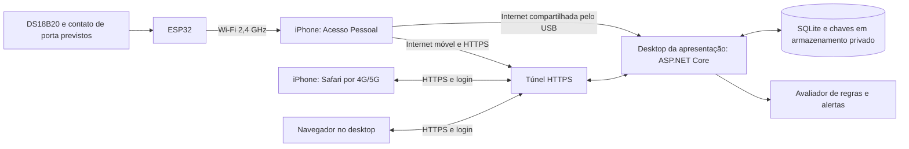

# Acesso por 4G/5G e apresentação — análise de viabilidade

Análise em 14/11/2026. **Proposta, ainda sem acesso público implantado.** O aplicativo continua no modo local existente. Não foi ativado túnel, criada conta, contratado serviço ou instalado driver por esta tarefa.

## 1. Condições confirmadas

- O usuário quer consultar pelo 4G/5G, inclusive ao apresentar em outro computador.
- A solução precisa ser gratuita, sem assinatura de hospedagem.
- Não haverá Wi-Fi da faculdade disponível para a demonstração.
- O desktop da apresentação não tem Wi-Fi.
- O usuário pode compartilhar a internet do iPhone pelo Acesso Pessoal.
- O usuário confirmou que o desktop não terá internet por rede, mas permite instalar o aplicativo/driver necessário para compartilhamento pelo USB. Esse será o caminho a ensaiar no computador de destino; a confirmação de permissão não comprova reconhecimento ou conexão funcionando.
- O usuário confirmou que o computador atual não ficará como servidor em casa. A API e o SQLite deverão executar no desktop da apresentação. Não depender de um servidor doméstico para a demonstração.
- ESP32/sonda ainda não tiveram recebimento ou teste físico confirmados; não tratar firmware compilado como integração física.

## 2. Execução no desktop da apresentação

Para manter custo de hospedagem zero e preservar ASP.NET Core/EF Core/SQLite/HTML/CSS/JS, usar **o desktop da apresentação como servidor**, com o banco em seu disco, e disponibilizar o acesso autenticado por um **túnel HTTPS**. A opção candidata é Tailscale Funnel no plano Personal, sujeito às condições de uso não comercial do fornecedor e à conferência da conta. O desktop receberá internet do iPhone pelo USB; não precisa ter adaptador Wi-Fi para esse caminho.

Funnel encaminha conexões externas para um serviço local e oferece endereço HTTPS; o visitante não precisa instalar o cliente. O guia informa disponibilidade em todos os planos, estado beta e limites de banda não configuráveis. O plano Personal é apresentado como gratuito para uso pessoal não comercial. Isso é transporte de rede: a API executa no desktop, não em uma hospedagem de aplicação gratuita. O conector precisará estar instalado e configurado no computador-servidor. [Funnel](https://tailscale.com/docs/features/tailscale-funnel), [planos](https://tailscale.com/pricing).

Será necessário preparar e ensaiar o desktop de destino antes da apresentação, incluindo aplicativo, banco, componente USB e conector HTTPS. Durante o uso, esse computador precisa estar ligado, sem suspensão e com internet. Dependemos do túnel e da rede móvel; não prometer operação sem conexão ou disponibilidade comercial garantida.

O desenho é a proposta futura, não evidência de sensores em funcionamento. A interface do computador e do celular consumiria a mesma API e o mesmo banco. O ESP32 preservaria credencial própria e UUID de medição; acesso do operador seria por login.

## 3. Como o desktop sem Wi-Fi terá internet

| Situação | Caminho | O que confirmar |
| --- | --- | --- |
| Ethernet com internet na faculdade | Navegador acessa o endereço público | A instituição permite o domínio e a conexão HTTPS |
| **Situação confirmada: sem Ethernet, com permissão para componente USB** | iPhone compartilha dados móveis pelo cabo USB | Testar Windows compatível, Apple Devices/iTunes, cabo de dados e reconhecimento do iPhone |
| Sem Ethernet e sem possibilidade de USB | Conectividade ainda não resolvida | Negociar alternativa com a faculdade antes de escolher a demonstração |

A Apple documenta o compartilhamento USB com Windows e exige Apple Devices ou iTunes instalado. Pode ser necessário confirmar a confiança no computador no iPhone. O cabo deve corresponder ao iPhone e transportar dados; o cabo micro USB do ESP32 tem outra finalidade. A permissão para instalar foi confirmada pelo usuário; a compatibilidade e o funcionamento no destino continuam pendentes. [Orientação da Apple](https://support.apple.com/pt-br/111785).

Nenhum aplicativo ou túnel fornece internet a um desktop completamente desconectado. O compartilhamento pelo USB e o Wi-Fi do Acesso Pessoal para o ESP32 precisam ser ensaiados simultaneamente no conjunto real.

Preparação a fazer antes da apresentação:

1. Conferir a versão do Windows, as portas USB e o conector do iPhone. Separar um cabo de dados compatível com ambos.
2. Instalar o componente oficial Apple enquanto houver uma conexão temporária disponível no desktop. Não depender de baixar esse componente no dia, quando o computador ainda não terá internet pelo telefone.
3. Conectar o iPhone, autorizar a confiança no aparelho e ativar o Acesso Pessoal. Confirmar que o desktop realmente navega usando os dados móveis.
4. Com o hardware disponível, conectar também o ESP32 ao hotspot de 2,4 GHz e verificar USB e Wi-Fi funcionando juntos.
5. Abrir a URL pública do ICEPLAY nos dois navegadores, autenticar e conferir a mesma geladeira, timestamps e origem das leituras. Esses passos só serão evidência após execução e registro.

## 4. Internet para o ESP32

Se levarmos a placa à apresentação, ela usará a rede Wi-Fi criada pelo iPhone. O ESP32 clássico planejado usa 2,4 GHz; não possui conexão celular nativa. Quando disponível no iPhone, **Maximizar Compatibilidade** restringe o hotspot a 2,4 GHz e WPA2. Conferir o modelo real e essa configuração antes do ensaio. [ESP32-WROOM-32](https://www.espressif.com/sites/default/files/documentation/esp32-wroom-32_datasheet_en.pdf), [segurança do hotspot Apple](https://support.apple.com/pt-br/guide/security/secfd166f620/web).

Será necessário configurar, de forma privada, SSID/senha do hotspot, URL pública da API, CA pública correta do serviço e credencial do dispositivo. A configuração atual do firmware é orientada ao IP/certificado local: o gerador precisa aceitar o perfil remoto sem sobrescrever configurações privadas existentes.

O firmware usa SNTP (`pool.ntp.org` e `time.google.com`) antes de enviar timestamps e validar TLS. Portanto o teste de rede deve incluir DNS, sincronização UTC e HTTPS, além de simplesmente conectar ao hotspot. Não ignorar certificado nem inventar horário quando a sincronização falhar. O buffer atual comporta apenas uma medição pendente por até 30 s; interrupções podem produzir lacunas e devem ser registradas.

Depois de gravada, a placa precisará de alimentação USB adequada e conferida, não de um ambiente de desenvolvimento para transmitir. Gravação/driver dependem da peça recebida e serão tratados na bancada.

Se o hardware ficar na geladeira em casa, poderá usar a rede daquele local; a apresentação poderá consultar as leituras remotamente. Se for levado à banca, distinguir teste de bancada ao vivo dos ensaios já feitos na geladeira. Não apresentar um teste de sonda na mesa como ensaio completo do equipamento refrigerado.

## 5. Onde executar e o que transportar

**Decisão do usuário:** o computador de casa não será o servidor da apresentação. Preparar o desktop de destino para executar a aplicação e manter o SQLite localmente. O celular e o navegador do desktop acessarão a mesma instância. Depois de encerrada essa execução, o acesso remoto não continuará disponível por conta própria.

**Pacote de execução a preparar:** publicação compatível com o Windows/arquitetura reais, arquivos estáticos, configuração por ambiente, iniciador e instruções. Uma publicação .NET autocontida inclui o runtime e dispensa instalar o SDK, mas precisa ser testada no destino e pode ser bloqueada por políticas da instituição. Levar separadamente uma cópia privada consistente do banco, os segredos necessários e o procedimento de backup/migrations. Não incluir essas informações no ZIP público de fontes. Esse pacote ainda não foi gerado nesta análise. [Publicação .NET](https://learn.microsoft.com/en-us/dotnet/core/deploying/).

O endereço Funnel é associado ao dispositivo/configuração. Mudar de computador-servidor não garante automaticamente a mesma URL. Configurar o conector no desktop de destino e definir o endereço antes de preparar o firmware para a apresentação; não deixar essa descoberta para o dia da banca. Não copiar identidades privadas de rede entre máquinas. Se não houver acesso antecipado ao destino, reavaliar o conector antes de implementá-lo: o domínio gratuito vinculado à conta do ngrok facilita a mudança de computador, mas tem as limitações da seção 7.

O ZIP de código já fornecido não inclui banco, SDK, certificados ou segredos. Não considerá-lo um pacote de execução offline completo. Backup/restauração devem preservar o original e ser verificados em diretório novo; não substituir um banco em uso para preparar a apresentação.

Verificar também o relógio do Windows, reconhecimento do iPhone, início/parada da aplicação e conector, preservação após reinício e restauração do backup. Se o desktop for compartilhado, combinar com o responsável a guarda dos dados e a retirada de credenciais após a apresentação, preservando antes uma cópia privada verificada.

## 6. Alterações de software necessárias antes de publicar

O código foi inspecionado: `MobileAccessSettings.IsLocal` libera o operador no loopback; `Allows` restringe a rede; `MobileAccessExtensions` usa certificados locais, hosts privados e chaves efêmeras. Apenas colocar um proxy na frente da porta 5080 não é uma implantação pública segura e funcional.

Preparar um **perfil remoto explícito**, mantendo o perfil local e os contratos existentes:

1. Login de operador com usuário/senha, hash apropriado e segredo privado, rate limit e CSRF. A página remota deve permitir entrar sem ter de parear com o computador. QR permanece disponível no fluxo local.
2. Retirar a exceção de autenticação de loopback no perfil remoto. O túnel chega por proxy local, mas isso não torna o visitante externo um operador autorizado.
3. Configurar domínio permitido e processamento de proxy/TLS com limites de confiança explícitos. Não aceitar cabeçalhos forjados como prova de HTTPS/identidade. Verificar o comportamento efetivo da versão do conector escolhida. [Orientação ASP.NET Core](https://learn.microsoft.com/en-us/aspnet/core/host-and-deploy/proxy-load-balancer?view=aspnetcore-10.0).
4. Definir chaves de sessão persistentes e protegidas, duração/saída e comportamento ao reiniciar. Hoje todas as sessões são invalidadas por reinício; qualquer mudança deve ter testes próprios. [Data Protection](https://learn.microsoft.com/en-us/aspnet/core/security/data-protection/configuration/overview?view=aspnetcore-10.0).
5. Manter API de dispositivos autenticada, configuração privada, mesmo SQLite/migrations e backups consistentes. Não criar dados automaticamente.
6. Preparar um iniciador e instruções de operação para API/conector, com erros claros e sem imprimir senhas/tokens. Não existe iniciador remoto pronto nesta versão.
7. Só depois dos testes, configurar a conta pessoal e ativar o acesso externo com o responsável. Não foi feita essa ativação por esta análise.

PWA pode ser um incremento posterior para ícone/abertura como aplicativo. O acesso remoto funcional pelo Safari e a validação física têm prioridade; não criar aplicativo nativo ou trocar banco/framework para resolver o transporte.

## 7. Alternativas examinadas

| Alternativa | Avaliação para as condições confirmadas |
| --- | --- |
| Desktop da apresentação + Funnel Personal | Candidato gratuito com banco local; requer preparar o computador e seu endereço antecipadamente, além de validar o plano e o acesso móvel |
| Desktop + ngrok gratuito | Domínio de desenvolvimento estável por conta facilita transportar o servidor; alternativa para ensaios/demonstração curta, com 20.000 requisições/mês e página intermediária em acesso HTML |
| Render gratuito com SQLite local | Descartado: arquivos efêmeros e suspensão por inatividade; o banco pode desaparecer ao reiniciar/reimplantar/suspender |
| Render pago com disco persistente | Tecnicamente possível sem trocar SQLite, mas não atende ao orçamento gratuito informado |

Pelo intervalo nominal de 10 s, uma estimativa teórica de um emissor contínuo é `86400 / 10 = 8640 POST/dia`, antes de reenvios, mudanças de porta e consultas do painel. Assim, 20.000 requisições não sustentariam sequer três dias ideais desse fluxo no ngrok gratuito. Uma demonstração curta pode caber na cota, mas é necessário conferir o consumo real da conta. Não confundir viabilidade para a banca com monitoramento contínuo sem limites. É cálculo de dimensionamento, não resultado experimental. [Limites ngrok](https://ngrok.com/docs/pricing-limits/free-plan-limits).

A documentação Render informa perda do filesystem local em serviços gratuitos ao reiniciar, reimplantar ou suspender e indisponibilidade de disco persistente no plano Free. Isso conflita com os critérios de persistência do ICEPLAY. [Plano gratuito](https://render.com/docs/free), [discos persistentes](https://render.com/docs/disks).

## 8. Entregas pequenas e critérios de aceitação

| Ordem | Entrega | Critério verificável |
| --- | --- | --- |
| 1 | Preparar desktop e pacote de execução | Windows/arquitetura conferidos; aplicativo publicado e banco privado preservado; internet USB comprovada no destino |
| 2 | Login e perfil remoto protegido | Sem sessão retorna 401; não existe bypass por loopback/cabeçalho; CSRF/origem/rate limit testados; perfil local preservado |
| 3 | Configurar e testar túnel no desktop de destino | URL HTTPS definida antes do firmware, acesso no iPhone por rede móvel, login e mesmos dados no desktop, sem perfil de CA local no novo acesso público |
| 4 | Operação e persistência | Reinício controlado mantém dados/migrations; backup consistente comparável; segredo ausente de logs/Git; procedimento de início/parada reproduzível |
| 5 | Firmware/rede móvel | Com hardware em mãos: hotspot, UTC, TLS, credencial e leituras físicas confirmadas na API/SQLite/interface |
| 6 | Ensaio da apresentação | Executar fluxo completo na rede e no computador de destino; registrar latências, falhas, recuperação e evidências reais |

Os testes de software já existentes continuam como regressão. Nenhum teste de acesso público, rede móvel, USB ou sensor físico foi executado nesta análise. Os 149 testes Node e os verificadores HTTP da etapa anterior são evidências distintas desse acesso remoto ainda pendente.

## 9. Plano de contingência e limites da demonstração

- Conferir sinal/franquia de dados e funcionamento do Acesso Pessoal no local antes da banca. O 4G/5G substitui a internet da faculdade, não a necessidade de conexão.
- Manter alimentação do telefone/placa e do computador-servidor; preparar a operação sem suspensão durante o período necessário.
- Se a conectividade falhar, apresentar backup local/histórico e vídeo de ensaio físico realmente realizado, explicitamente identificados como apoio, sem alegar transmissão ao vivo.
- Uma demonstração de aquisição física totalmente offline exigiria projeto de rede/relógio/configuração próprio; não está garantida pelo firmware atual.
- Ensaiar a conexão USB autorizada no desktop da apresentação antes da banca. Se o iPhone não for reconhecido ou o compartilhamento falhar, a exibição online no desktop continua pendente de uma solução de conectividade.

Meta: ensaiar e estabilizar antes da entrega funcional de 24/11 e da apresentação de 01/12, sem prometer datas de conclusão antes de confirmar infraestrutura, conta e chegada do hardware. Referências técnicas consultadas em 14/11/2026; revalidar condições dos serviços antes de ativar.
