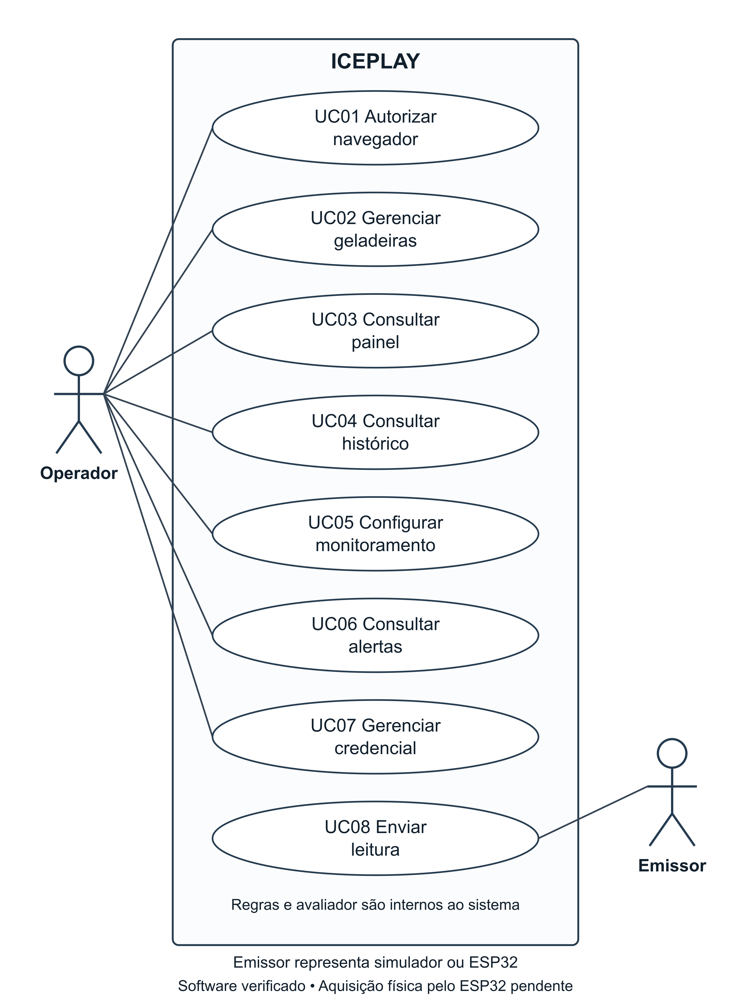
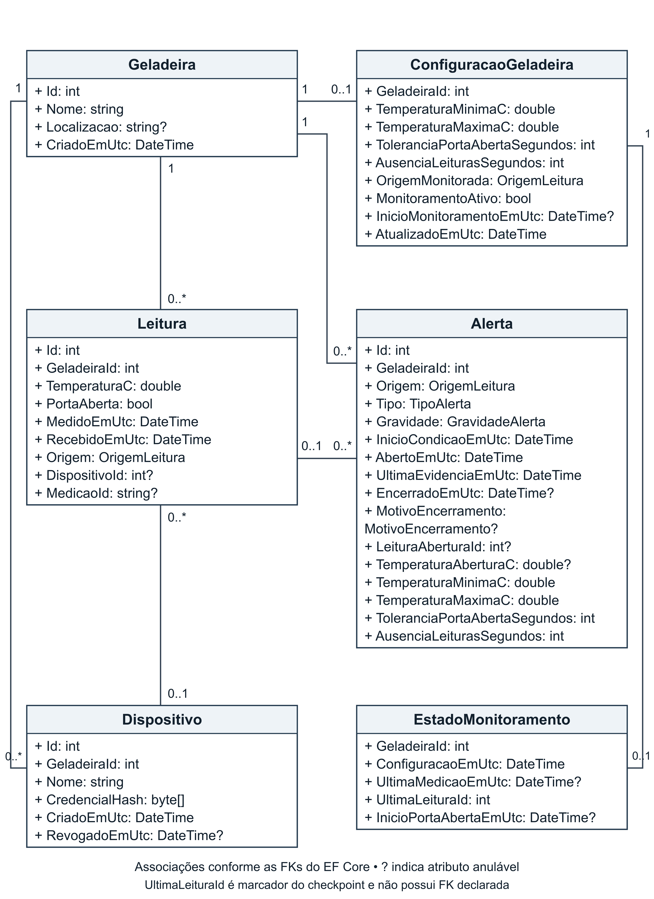
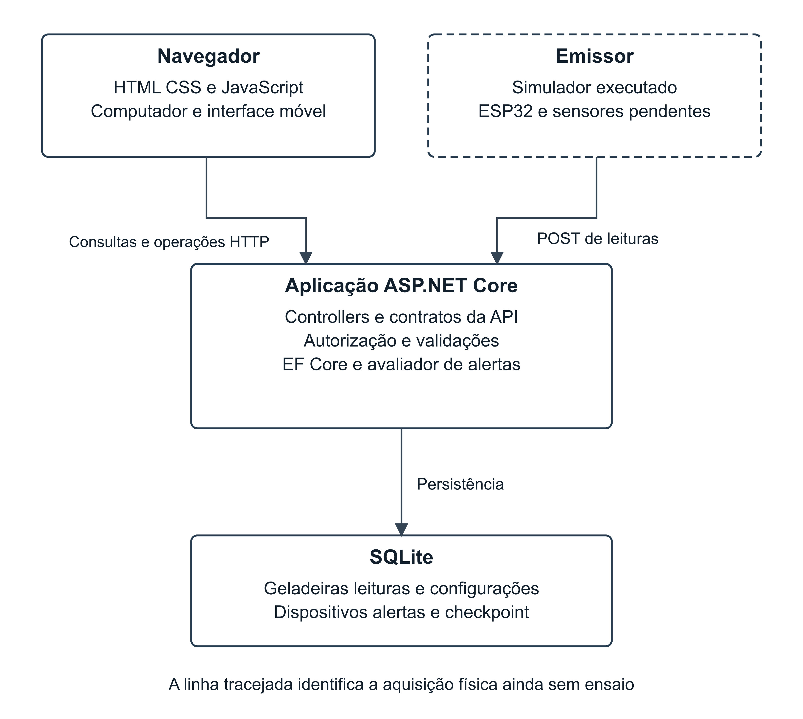

# ICEPLAY Requisitos modelagem e validação

Material de apoio ao TCC de Ciência da Computação. Revisão técnica de 17/11/2026. Código de aplicação auditado: `98dabcc7888239de896db8410ee44b2ddfde831e`. O material reúne requisitos, casos de uso, classes e resultados verificáveis para inserção nos capítulos de Projeto e Desenvolvimento. Não substitui revisão do aluno/orientador, normalização final ou resultados físicos ainda não executados.

## 1 Finalidade e escopo

O ICEPLAY monitora temperatura e estado da porta de geladeiras comerciais, armazena histórico, apresenta painel web responsivo e registra episódios de alertas segundo parâmetros explícitos. A arquitetura preserva ASP.NET Core Web API, EF Core, SQLite e HTML/CSS/JavaScript na mesma aplicação. Não aciona o compressor nem comprova condições sanitárias.

O levantamento foi consolidado das solicitações do responsável, do planejamento, dos contratos e do código real. Não foram inventadas entrevistas, questionários, aprovação de usuários ou experimentos. O operador administra e consulta; o emissor fornece leituras. Simulador e ESP32 ocupam o papel externo de emissor, mas só o cliente de software foi exercitado na ingestão.

Software foi verificado em bancos isolados em 17/11. O firmware tem compilação histórica de 12/11; o USB da placa foi reconhecido em 16/11, com COM3/status OK. Gravação, aquisição de sensores e ensaio na geladeira continuam pendentes. O login implementado é local por código/QR; contas individuais e perfil público por 4G não estão implementados.

## 2 Requisitos funcionais

| ID | Requisito | Critério de aceitação | Situação |
| --- | --- | --- | --- |
| RF01 | Consultar a saúde real da API e do SQLite | Retornar 200 quando conectado e 503 para indisponibilidade exercitada pelo verificador. | Software verificado |
| RF02 | Navegar por páginas independentes | Acessar e atualizar URLs próprias; rota inexistente retorna 404. | HTTP e DOM verificados |
| RF03 | Gerenciar geladeiras | Cadastrar, listar, consultar, editar e excluir com validação; preservar registros após reinício. | Software verificado |
| RF04 | Receber temperatura e estado da porta | Persistir leitura válida de uma geladeira existente; rejeitar campos obrigatórios ausentes. | API verificada; aquisição física pendente |
| RF05 | Separar os dois instantes UTC | Aceitar medição UTC válida e não futura; gerar recebimento no servidor e armazenar ambos. | Software verificado |
| RF06 | Identificar a origem das leituras | Usar Simulacao ou Hardware; filtrar histórico e painel por origem. O rótulo não comprova sensor. | Software verificado |
| RF07 | Consultar histórico filtrado e paginado | Filtrar equipamento, origem e período; validar paginação de 1 a 100 itens por página. | Software verificado |
| RF08 | Consultar o painel responsivo | Exibir última medição por origem, temperatura, porta, idade e estados sem dados/erro. | Dados e DOM verificados; revisão visual parcial |
| RF09 | Identificar temperatura e porta anormais | Com monitoramento ativo, abrir episódios fora da faixa e por sequência observada de porta aberta. | Regras de software verificadas |
| RF10 | Detectar ausência de leituras | Avaliar a idade da medição ou início do acompanhamento, mesmo sem novo POST. | Software verificado |
| RF11 | Registrar e consultar episódios de alerta | Persistir abertura, evidências e encerramento; consultar filtros e resumo sem duplicar episódio aberto. | Software verificado |
| RF12 | Executar simulação pela mesma API | Simulador envia amostras identificadas como Simulacao, sem cadastrar equipamentos automaticamente. | Simulação de software executada |
| RF13 | Integrar ESP32 e sensores físicos | Ler DS18B20 e contato de porta; enviar por HTTPS; verificar montagem, aquisição e ensaio na geladeira. | Parcial: compilação histórica e USB; sensores pendentes |
| RF14 | Configurar monitoramento por geladeira | Persistir faixa, tempos positivos, origem e ativação explícitos, sem parâmetros automáticos no banco. | Software verificado |
| RF15 | Autorizar emissor e evitar duplicação | Vincular credencial ao equipamento; repetir UUID/conteúdo retorna o mesmo registro; alteração gera 409. | Software verificado por cliente de teste |
| RF16 | Autorizar navegador no acesso móvel local | HTTPS, sessão, CSRF, código ou convite QR de 120 s e uso único; saída e expiração da sessão. | TLS/HTTP e scripts verificados; câmera real pendente |

## 3 Requisitos não funcionais

| ID | Requisito | Critério | Estado e limite |
| --- | --- | --- | --- |
| RNF01 | Execução reproduzível | SDK e pacotes fixados; setup, build e verificadores executáveis. | Verificado neste PC; pacote de apresentação pendente. |
| RNF02 | Persistência e integridade | Migrations, restrições e dados mantidos após reinício nos testes isolados. | Verificado; banco de uso preservado. |
| RNF03 | Contratos e erros compreensíveis | Respostas coerentes para entrada inválida, ausência, conflito, autorização e falha. | 400, 401, 403, 404, 409 e 503 exercitados conforme cenário. |
| RNF04 | Consistência temporal | Contrato e armazenamento em UTC, com medição e recebimento distintos. | Verificado em software; relógio físico pendente. |
| RNF05 | Organização do código | Separar contratos, controllers, entidades, persistência, regras e arquivos da interface. | Estrutura inspecionada; não é métrica de qualidade absoluta. |
| RNF06 | Integridade das evidências | Distinguir fixtures, simulação, testes de software e ensaio físico. | Logs e JSONs desta rodada preservados; sem resultados físicos fabricados. |
| RNF07 | Usabilidade e responsividade | Navegação, mensagens, estados e teclado; conferir visualmente desktop e Safari. | DOM/HTTP verificados; validação visual completa ainda pendente. |
| RNF08 | Dependências justificadas | Preservar arquitetura e versões; não exigir framework frontend ou banco servidor. | Dois pacotes NuGet diretos na API; testes usam ferramentas documentadas. |
| RNF09 | Limites operacionais explícitos | Instância e arquivo local; documentar dependência de servidor, rede e amostragem. | Não há ensaio de disponibilidade contínua ou implantação distribuída. |
| RNF10 | Segurança conforme a implantação | HTTPS, sessão/CSRF e credencial de dispositivo no modo local protegido. | Verificado nesse escopo; perfil público e login por usuário/senha pendentes. |
| RNF11 | Consultas com crescimento controlado | Paginação, filtros e índices; controlar tamanho da resposta. | Funcionalidade verificada; benchmark representativo não executado. |
| RNF12 | Transparência acadêmica | Registrar assistência de IA e manter revisão, compreensão e defesa pelo aluno. | Assistência declarada; aprovação acadêmica não presumida. |

## 4 Regras de negócio

| ID | Regra |
| --- | --- |
| RN01 | Nome da geladeira obrigatório até 100 caracteres; localização opcional até 200. Identificadores e criação são controlados pelo servidor. |
| RN02 | Excluir geladeira com leituras ou alertas retorna conflito e preserva o histórico. Não há exclusão em cascata dessas evidências. |
| RN03 | Medição deve ser UTC com sufixo Z e não posterior ao recebimento. O servidor não corrige silenciosamente o horário. |
| RN04 | Zero de temperatura e false para porta são valores válidos. Simulacao e Hardware são origens distintas e explícitas. |
| RN05 | Monitoramento exige configuração explícita e ativa. Mínima é menor que máxima; tempos são inteiros positivos; origem é única por equipamento. |
| RN06 | Os limites da faixa são inclusivos: estar exatamente na mínima ou máxima não abre alerta de temperatura. |
| RN07 | Porta por duração depende de medições que confirmem a sequência. Lacunas interrompem a contagem; tempo sem medição não prova porta aberta continuamente. |
| RN08 | Ausência é avaliada periodicamente pela idade da medição. Reenvio de uma medição antiga não renova sua atualidade. |
| RN09 | Há no máximo um episódio aberto por geladeira, origem e tipo. Encerramento distingue normalização, falta de dados, alteração e desativação. |
| RN10 | Dispositivo autenticado envia somente para o equipamento vinculado. Mesmo UUID e corpo retornam o registro existente; corpo diferente retorna conflito. |
| RN11 | O segredo do dispositivo é exibido uma vez e persistido como hash. O rótulo Hardware e a credencial não substituem evidência de aquisição física. |
| RN12 | Convite QR tem 120 segundos e um uso; sessão dura até 8 horas e termina ao reiniciar o servidor atual. Acesso por usuário/senha ainda não existe. |

## 5 Casos de uso

O limite do diagrama é a aplicação ICEPLAY. Operador e emissor são papéis externos. Relógio, SQLite e avaliador pertencem à implementação interna e não são atores deste modelo. Os casos expressam objetivos observáveis; consultar um alerta não o encerra manualmente. A notação é referenciada na especificação UML 2.5.1 da OMG.

Fonte: elaboração assistida por IA a partir do código e requisitos do ICEPLAY, 2026. A aquisição real pelo ESP32 continua pendente.

| Caso | Objetivo | Ator | Requisitos |
| --- | --- | --- | --- |
| UC01 | Autorizar navegador | Operador | RF16 |
| UC02 | Gerenciar geladeiras | Operador | RF03 |
| UC03 | Consultar painel | Operador | RF01 RF02 RF08 |
| UC04 | Consultar histórico | Operador | RF05 RF06 RF07 |
| UC05 | Configurar monitoramento | Operador | RF14 RF09 RF10 |
| UC06 | Consultar alertas | Operador | RF11 |
| UC07 | Gerenciar credencial | Operador | RF15 |
| UC08 | Enviar leitura | Emissor de leituras | RF04 RF05 RF06 RF12 RF13 RF15 |

### UC01 Autorizar navegador

| Campo | Especificação |
| --- | --- |
| Ator | Operador |
| Objetivo | Autorizar consultas e alterações pelo navegador móvel na rede local preparada. |
| Pré-condições | Aplicação no modo móvel, endereço HTTPS correto e certificado confiável. Computador local disponível para emitir o convite. |
| Fluxo principal | 1. Operador abre Acesso no computador e gera convite. 2. No celular, abre o endereço preparado e usa Ler QR Code. 3. Confirma a conexão. 4. Servidor valida convite e emite sessão e proteção CSRF. |
| Alternativas e exceções | Código manual permanece disponível. Convite expirado, cancelado ou já consumido é recusado; entrada inválida não cria sessão. Há limite de tentativas. |
| Pós-condições | Sessão autoriza o navegador; Sair a encerra. O fluxo foi verificado em TLS/HTTP e scripts; câmera real do iPhone ainda requer confirmação. |
| Rastreabilidade | RF16; TV14 TV15 |

### UC02 Gerenciar geladeiras

| Campo | Especificação |
| --- | --- |
| Ator | Operador |
| Objetivo | Manter o cadastro dos equipamentos que serão monitorados. |
| Pré-condições | Aplicação e SQLite disponíveis; operador autorizado no modo de acesso utilizado. |
| Fluxo principal | 1. Abre Geladeiras e consulta a lista. 2. Informa nome e localização para cadastrar. 3. API valida e persiste. 4. Operador consulta detalhes ou edita. 5. Para excluir, confirma a ação na interface. |
| Alternativas e exceções | Entrada inválida retorna 400. Consulta/alteração/exclusão de ID inexistente retorna 404. Havendo leituras ou alertas, exclusão retorna 409. |
| Pós-condições | Cadastro consistente e persistente após reinício; exclusão não elimina o histórico vinculado. |
| Rastreabilidade | RF03; TV02 TV03 |

### UC03 Consultar painel

| Campo | Especificação |
| --- | --- |
| Ator | Operador |
| Objetivo | Consultar a situação disponível de cada equipamento com contexto temporal e de origem. |
| Pré-condições | Aplicação acessível; permissões de acesso atendidas. |
| Fluxo principal | 1. Abre Visão geral. 2. Interface consulta saúde da API/banco e monitoramento. 3. Operador escolhe a origem. 4. Consulta última leitura, temperatura, porta, idade e resumo de alertas. |
| Alternativas e exceções | Sem cadastro ou leitura, a interface informa ausência. Falha de consulta é apresentada. Referência visual de 60 s indica leitura desatualizada e não comprova desconexão. |
| Pós-condições | Painel apresenta a informação obtida da API, sem fabricar medição ou inferir estado físico atual durante ausência de dados. |
| Rastreabilidade | RF01 RF02 RF08; TV01 TV07 TV13 TV15 |

### UC04 Consultar histórico

| Campo | Especificação |
| --- | --- |
| Ator | Operador |
| Objetivo | Investigar as leituras persistidas de um equipamento e uma origem. |
| Pré-condições | Geladeira cadastrada e acesso autorizado. |
| Fluxo principal | 1. Abre Histórico. 2. Seleciona geladeira, origem e período. 3. Solicita a consulta. 4. Examina tabela e gráfico dos pontos da página. 5. Navega entre páginas. |
| Alternativas e exceções | Filtros inválidos retornam 400; equipamento inexistente retorna 404. Ausência de registros produz resultado vazio. Gráfico representa somente a página consultada. |
| Pós-condições | Consulta mantém origem e dois timestamps identificados, sem alterar as leituras. |
| Rastreabilidade | RF05 RF06 RF07; TV06 |

### UC05 Configurar monitoramento

| Campo | Especificação |
| --- | --- |
| Ator | Operador |
| Objetivo | Definir a faixa, os tempos e a origem utilizados pelas regras de um equipamento. |
| Pré-condições | Geladeira existente e operador autorizado para gravar configurações. |
| Fluxo principal | 1. Abre Configurações e seleciona a geladeira. 2. Consulta os parâmetros existentes. 3. Informa mínima, máxima, tolerância de porta, ausência, origem e ativação. 4. Confirma a gravação. 5. Servidor valida e persiste. |
| Alternativas e exceções | Mínima maior/igual à máxima, valores não finitos, tempos não positivos, campos ausentes ou origem inválida são rejeitados. Sem configuração, não são criados parâmetros automaticamente. |
| Pós-condições | Avaliador interno utiliza a configuração ativa. Alteração/desativação tem efeitos próprios nos episódios; não é ação de normalizar manualmente um alerta. |
| Rastreabilidade | RF14 RF09 RF10; TV08 TV09 TV10 TV11 |

### UC06 Consultar alertas

| Campo | Especificação |
| --- | --- |
| Ator | Operador |
| Objetivo | Consultar ocorrências e seus motivos, sem confundir ausência de dados com normalidade. |
| Pré-condições | Aplicação disponível e acesso autorizado; episódios só existem quando as regras os geram. |
| Fluxo principal | 1. Abre Alertas. 2. Define filtros de equipamento, origem, tipo, gravidade, situação ou período. 3. Consulta a página. 4. Examina datas, evidência de abertura e motivo de encerramento. |
| Alternativas e exceções | Filtros inválidos são rejeitados; consulta sem ocorrências é vazia. Não há confirmação/encerramento manual implementado. |
| Pós-condições | Episódios continuam preservados no SQLite; consulta não altera sua situação. Geração e encerramento são responsabilidades internas das regras. |
| Rastreabilidade | RF11; TV09 TV10 TV11 TV13 TV15 |

### UC07 Gerenciar credencial

| Campo | Especificação |
| --- | --- |
| Ator | Operador |
| Objetivo | Autorizar e revogar o emissor vinculado a uma geladeira. |
| Pré-condições | Geladeira existente e sessão de operador com condições de segurança atendidas. |
| Fluxo principal | 1. Abre Configurações e Conectar ESP32. 2. Informa nome e confirma emissão. 3. Guarda o segredo exibido uma vez em configuração privada. 4. Consulta a situação do dispositivo. 5. Pode revogar explicitamente a credencial. |
| Alternativas e exceções | Não é criada credencial automaticamente. Nome inválido é recusado; segundo dispositivo ativo para a mesma geladeira conflita. Credencial revogada não autoriza novos envios. |
| Pós-condições | Banco mantém hash e vínculo, sem segredo em claro. O navegador do operador e o dispositivo possuem mecanismos de autenticação distintos. |
| Rastreabilidade | RF15; TV12 |

### UC08 Enviar leitura

| Campo | Especificação |
| --- | --- |
| Ator | Emissor de leituras |
| Objetivo | Registrar uma amostra pela API comum ao simulador e ao futuro emissor físico. |
| Pré-condições | Geladeira existente, corpo válido e transporte permitido. No envio por dispositivo, Bearer ativo e UUID identificam o equipamento e a medição. |
| Fluxo principal | 1. Emissor obtém ou produz a amostra identificada. 2. Envia temperatura, porta, medição UTC, origem e identificação aplicável. 3. API valida contrato e autorização. 4. Persiste recebimento UTC e retorna 201 com ID/Location. 5. Reenvio autenticado idêntico retorna 200 com o mesmo registro. |
| Alternativas e exceções | Dados inválidos retornam 400; equipamento ausente, 404; credencial inválida/revogada, 401; vínculo/origem não autorizados, 403; UUID com conteúdo diferente, 409. Simulador usa origem Simulacao. |
| Pós-condições | Amostra fica disponível para consultas e para avaliação assíncrona. Fluxo foi testado com emissores de software; aquisição pelo ESP32 e sensores ainda não foi executada. |
| Rastreabilidade | RF04 RF05 RF06 RF12 RF13 RF15; TV04 TV05 TV12 TV17 |

## 6 Classes e persistência

O diagrama representa as seis classes de entidade existentes em Models. Mostra os atributos públicos completos e as associações declaradas em IceplayDbContext. As classes armazenam estado; validações, operações HTTP e avaliação ficam nos contratos/controllers/serviços. Não foram inventados métodos nas entidades.

Fonte: Models e IceplayDbContext do ICEPLAY, versão 98dabcc. ? indica nulabilidade C#. Uma leitura pode não ter dispositivo nos registros legados; o checkpoint UltimaLeituraId é marcador sem FK declarada.

| Classe origem | Classe relacionada | Multiplicidade origem | Multiplicidade relacionada | FK | Exclusão no EF |
| --- | --- | --- | --- | --- | --- |
| Geladeira | Leitura | 1 | 0..* | Leitura.GeladeiraId | Restrict |
| Geladeira | ConfiguracaoGeladeira | 1 | 0..1 | ConfiguracaoGeladeira.GeladeiraId | Cascade |
| Geladeira | Alerta | 1 | 0..* | Alerta.GeladeiraId | Restrict |
| Geladeira | Dispositivo | 1 | 0..* | Dispositivo.GeladeiraId | Cascade |
| ConfiguracaoGeladeira | EstadoMonitoramento | 1 | 0..1 | EstadoMonitoramento.GeladeiraId | Cascade |
| Dispositivo | Leitura | 0..1 | 0..* | Leitura.DispositivoId | Restrict |
| Leitura | Alerta | 0..1 | 0..* | Alerta.LeituraAberturaId | Restrict |

Multiplicidades são lidas na ponta indicada: cada leitura pertence a uma geladeira; uma geladeira tem zero ou muitas leituras. A ponta Dispositivo é 0..1 porque o vínculo da leitura é anulável. Uma configuração pode ter zero ou um checkpoint. As restrições de exclusão de leituras/alertas preservam histórico. O índice de dispositivo ativo permite no máximo um ativo por geladeira, preservando revogados anteriores.

### Dicionário de atributos

#### Geladeira

| Atributo | Tipo C# | Anulável |
| --- | --- | --- |
| Id | int | Não |
| Nome | string | Não |
| Localizacao | string? | Sim |
| CriadoEmUtc | DateTime | Não |

#### Leitura

| Atributo | Tipo C# | Anulável |
| --- | --- | --- |
| Id | int | Não |
| GeladeiraId | int | Não |
| TemperaturaC | double | Não |
| PortaAberta | bool | Não |
| MedidoEmUtc | DateTime | Não |
| RecebidoEmUtc | DateTime | Não |
| Origem | OrigemLeitura | Não |
| DispositivoId | int? | Sim |
| MedicaoId | string? | Sim |

#### ConfiguracaoGeladeira

| Atributo | Tipo C# | Anulável |
| --- | --- | --- |
| GeladeiraId | int | Não |
| TemperaturaMinimaC | double | Não |
| TemperaturaMaximaC | double | Não |
| ToleranciaPortaAbertaSegundos | int | Não |
| AusenciaLeiturasSegundos | int | Não |
| OrigemMonitorada | OrigemLeitura | Não |
| MonitoramentoAtivo | bool | Não |
| InicioMonitoramentoEmUtc | DateTime? | Sim |
| AtualizadoEmUtc | DateTime | Não |

#### Dispositivo

| Atributo | Tipo C# | Anulável |
| --- | --- | --- |
| Id | int | Não |
| GeladeiraId | int | Não |
| Nome | string | Não |
| CredencialHash | byte[] | Não |
| CriadoEmUtc | DateTime | Não |
| RevogadoEmUtc | DateTime? | Sim |

#### Alerta

| Atributo | Tipo C# | Anulável |
| --- | --- | --- |
| Id | int | Não |
| GeladeiraId | int | Não |
| Origem | OrigemLeitura | Não |
| Tipo | TipoAlerta | Não |
| Gravidade | GravidadeAlerta | Não |
| InicioCondicaoEmUtc | DateTime | Não |
| AbertoEmUtc | DateTime | Não |
| UltimaEvidenciaEmUtc | DateTime | Não |
| EncerradoEmUtc | DateTime? | Sim |
| MotivoEncerramento | MotivoEncerramento? | Sim |
| LeituraAberturaId | int? | Sim |
| TemperaturaAberturaC | double? | Sim |
| TemperaturaMinimaC | double | Não |
| TemperaturaMaximaC | double | Não |
| ToleranciaPortaAbertaSegundos | int | Não |
| AusenciaLeiturasSegundos | int | Não |

#### EstadoMonitoramento

| Atributo | Tipo C# | Anulável |
| --- | --- | --- |
| GeladeiraId | int | Não |
| ConfiguracaoEmUtc | DateTime | Não |
| UltimaMedicaoEmUtc | DateTime? | Sim |
| UltimaLeituraId | int | Não |
| InicioPortaAbertaEmUtc | DateTime? | Sim |

### Enumerações

| Tipo | Valores |
| --- | --- |
| OrigemLeitura | Simulacao; Hardware |
| TipoAlerta | TemperaturaForaFaixa; PortaAberta; AusenciaLeituras |
| GravidadeAlerta | Atencao; Critico |
| MotivoEncerramento | CondicaoNormalizada; SemDadosRecentes; ConfiguracaoAlterada; MonitoramentoDesativado |

## 7 Arquitetura e integração

Fonte: código e contratos do ICEPLAY, 2026. A fronteira tracejada marca a aquisição física pendente. O navegador consulta a API, nunca o arquivo SQLite diretamente. O POST persiste a leitura; o avaliador executa em ciclo separado, portanto alertas são assíncronos. Firmware não segue redirecionamento nem ignora TLS; a rede física precisa validar Wi-Fi, UTC e HTTPS.

## 8 Método e resultados de validação

Os scripts existentes foram executados sequencialmente, com nova pasta de evidências e bancos em .tools/verification. A aprovação exige asserções satisfeitas e código de término sem falha. Testes negativos esperam respostas de erro específicas e não contam como falhas do sistema quando o contrato é cumprido. As quantidades abaixo são contagens dos verificadores, não quantidade de funcionalidades, cobertura ou resultados térmicos. Polling de inicialização pode variar contagens de requisições.

| Conjunto | Verificações ou testes | Requisições | Resultado | Arquivo em evidências |
| --- | --- | --- | --- | --- |
| Base e saúde | 13 | Não contabilizado neste relatório | Aprovado | verify/smoke-latest.json |
| Cadastro de geladeiras | 807 | 177 | Aprovado | verify-geladeiras/crud-api.json |
| Ingestão e SQLite | 339 | 75 | Aprovado | verify-leituras/leituras-api.json |
| Histórico | 145 | 68 | Aprovado | verify-historico/historico-api.json |
| Painel | 70 | 29 | Aprovado | verify-monitoramento/monitoramento-api.json |
| Configurações | 153 | 67 | Aprovado | verify-configuracoes/configuracoes-api.json |
| Alertas HTTP | 92 | 68 | Aprovado | verify-alertas/alertas-api.json |
| Dispositivos | 85 | 56 | Aprovado | verify-dispositivos/dispositivos-api.json |
| Páginas HTTP e DOM | 216 | 52 | Aprovado | verify-pages/pages-api.json |
| Acesso móvel TLS e HTTP | 181 | 137 | Aprovado | verify-mobile/mobile-api.json |
| Convites com relógio controlado | 13 | Não contabilizado neste relatório | Aprovado | verify-mobile/pareamento-regras.json |
| Avaliador com relógio controlado | 31 | Não se aplica | Aprovado | verify-alertas/regras.log |
| JavaScript | 149 | Não se aplica | Aprovado | javascript.log |

O setup/build terminou com zero avisos e zero erros. A rodada completa e o código de origem estão registrados em [rodada.json](../../evidencias/2026-11-17-modelagem-validacao/rodada.json). Regras usam relógio controlado somente no programa de verificação. Testes JavaScript usam DOM/câmera controlados; HTTP/DOM não equivalem a inspeção visual ou uso real da câmera do iPhone.

### Cenários de validação

| ID | Requisitos | Cenário | Resultado esperado | Resultado observado | Natureza |
| --- | --- | --- | --- | --- | --- |
| TV01 | RF01 | Saúde e indisponibilidade | API consulta o SQLite; cenário de falha retorna 503. | Aprovado no verificador base com 13 verificações. | Software |
| TV02 | RF03 RNF02 | Cadastro e reinício | Operações válidas persistem; após reiniciar a API os registros permanecem. | Aprovado no conjunto CRUD, com verificação de reinício. | Software |
| TV03 | RF03 RNF03 | Entradas inválidas e IDs ausentes | 400 para dados inválidos, 404 para IDs inexistentes e 409 para excluir equipamento com histórico. | Cenários negativos aprovados no conjunto CRUD. | Software |
| TV04 | RF04 RF05 RF06 RF12 | Contrato de leitura | UTC e campos obrigatórios válidos; zero/false aceitos; origem explícita; medição futura recusada. | Aprovado no conjunto de ingestão, com fixtures identificadas. | Software e simulação |
| TV05 | RF05 RNF02 RNF04 | Integridade e atualização do banco | Preservar dados anteriores ao aplicar migrations e respeitar vínculos/restrições. | Upgrade, chaves estrangeiras e banco final aprovados. | Software em SQLite isolado |
| TV06 | RF07 RNF11 | Filtros e paginação | Separar geladeira/origem; filtrar período UTC, ordenar e rejeitar paginação inválida. | 145 verificações e 68 requisições aprovadas. | Software |
| TV07 | RF08 RF12 | Última leitura e ausência de dados | Exibir a última medição por origem e informar estados de ausência, erro e desatualização. | 70 verificações HTTP; estados da interface incluídos nos testes JavaScript. | Software e simulação |
| TV08 | RF14 | Parâmetros e persistência | Mínima menor que máxima, tempos positivos, origem/ativação explícitas e persistência. | 153 verificações e 67 requisições aprovadas. | Software |
| TV09 | RF09 RF11 | Temperatura e episódios | Limites inclusivos; desvio abre episódio; repetição não duplica; normalização encerra. | Aprovado entre 31 asserções com relógio controlado e no HTTP de alertas. | Regra de software |
| TV10 | RF09 RF11 | Duração da porta | Exigir sequência observada; lacunas interrompem a contagem; não inventar duração anterior. | Cenários de sequência, limiar e lacuna aprovados no avaliador. | Regra de software |
| TV11 | RF10 RF11 | Ausência sem novo envio | Abrir ausência pelo prazo mesmo sem POST; upload antigo não renova; recuperação encerra. | Cenários temporais e persistência de episódios aprovados. | Regra de software |
| TV12 | RF15 RNF10 | Credencial e idempotência | Validar vínculo/revogação; reenvio idêntico não duplica; mesmo UUID com conteúdo diferente gera 409. | 85 verificações e 56 requisições aprovadas. | Cliente de software autenticado |
| TV13 | RF02 RNF07 | URLs e documentos | Acesso direto e atualização das páginas funcionam; links/elementos esperados existem; 404 permanece. | 216 verificações e 52 requisições aprovadas; não é inspeção visual. | HTTP e DOM |
| TV14 | RF16 RNF10 | TLS sessão CSRF e QR | Validar HTTPS, autorização, origem, convite de uso único, expiração, cancelamento e reinício. | 181 verificações HTTP/TLS e 13 asserções de convite aprovadas. | Software sem iPhone físico |
| TV15 | RF02 RF08 RF16 | Comportamento JavaScript | Preservar estados, navegação, leitor QR, confirmação e liberação dos recursos da câmera. | 149 testes passaram, zero falhas; câmera e DOM são controlados nos testes. | Testes automatizados com mocks |
| TV16 | RF13 | Reconhecimento USB | Driver reconhece o CP2102 e atribui porta sem erro. | Parcial em 16/11: COM3, status OK, problema 0; firmware não gravado. | Reconhecimento físico parcial anterior |
| TV17 | RF13 RF04 RF09 RF10 | Aquisição real e geladeira | Executar F02 a F12: sensores, rede, persistência, regras, recuperação e observação na geladeira. | Não executado. Não há medição física ou resultado térmico nesta entrega. | Ensaio físico pendente |
| TV18 | RNF01 RNF09 RNF10 | Apresentação em outro computador | Validar pacote, rede móvel/hotspot, endereço HTTPS e acesso no destino. | Não executado; pacote e perfil remoto ainda não implementados. | Implantação pendente |

### Rastreabilidade

| Requisito | Casos de uso | Validações |
| --- | --- | --- |
| RF01 | UC03 | TV01 |
| RF02 | UC01 UC02 UC03 UC04 UC05 UC06 UC07 | TV13 TV15 |
| RF03 | UC02 | TV02 TV03 |
| RF04 | UC08 | TV04 |
| RF05 | UC04 UC08 | TV04 TV05 |
| RF06 | UC03 UC04 UC08 | TV04 TV06 TV07 |
| RF07 | UC04 | TV06 |
| RF08 | UC03 | TV07 TV13 TV15 |
| RF09 | UC05 UC06 | TV09 TV10 |
| RF10 | UC05 UC06 | TV11 |
| RF11 | UC06 | TV09 TV10 TV11 |
| RF12 | UC08 | TV04 TV07 |
| RF13 | UC08 | TV16 TV17 |
| RF14 | UC05 | TV08 |
| RF15 | UC07 UC08 | TV12 |
| RF16 | UC01 | TV14 TV15 |

## 9 Evidências físicas e pendências

O registro de 16/11 demonstra detecção do CP2102 pelo Windows e COM3 sem erro após instalação autorizada. F01 é parcial, pois não houve gravação nem inicialização do firmware ICEPLAY. Não se atribui esse resultado a uma medição de DS18B20 ou de porta. F02 a F12 e o acesso por rede móvel no computador de apresentação continuam pendentes.

Após os ensaios, registrar data, local, versão, montagem/pinagem, configuração, duração observada, resultado esperado/obtido, falhas, correção e reteste, além de fotos, vídeo, log sem segredos e dados persistidos. Precisão exige método e referência de comparação; não pode ser concluída pela compilação ou pelo rótulo Hardware.

## 10 Como inserir no TCC

No capítulo Projeto, inserir finalidade, tabelas de RF/RNF/regras, diagrama e especificações de casos de uso e diagrama de classes. No capítulo Desenvolvimento ou Resultados, inserir método, cenários, resultados e evidências. Ajustar a numeração das figuras/tabelas à sequência da monografia e atualizar listas e sumário no Word. Conclusão, resumo e artigo devem ser revistos após a validação física. Este material não inclui aprovação, assinatura ou RA.

## 11 Fontes e assistência

- Código do ICEPLAY: Models, Data/IceplayDbContext, Contracts, Controllers, Monitoring, Mobile e scripts de verificação, versão 98dabcc7888239de896db8410ee44b2ddfde831e.

- Requisitos/modelagem anteriores: docs/planejamento.md, docs/requisitos-rastreabilidade.md e docs/modelagem-atual.md; contratos e protocolo físico do repositório.

- OBJECT MANAGEMENT GROUP. Unified Modeling Language, versão 2.5.1. Dezembro de 2017. [Página oficial da especificação](https://www.omg.org/spec/UML/2.5.1/About-UML). Consultada em 17 nov. 2026. Referência de notação, não resultado experimental.

- Modelo TCC UNIP fornecido pelo responsável: referência de organização e formatação; original preservado.

Material preparado com assistência de IA para inspeção do código, organização, geração de figuras e execução/verificação de testes. O responsável pelo TCC deve revisar, compreender, reproduzir e defender o conteúdo; não há declaração de aprovação institucional ou de autoria independente de assistência.
