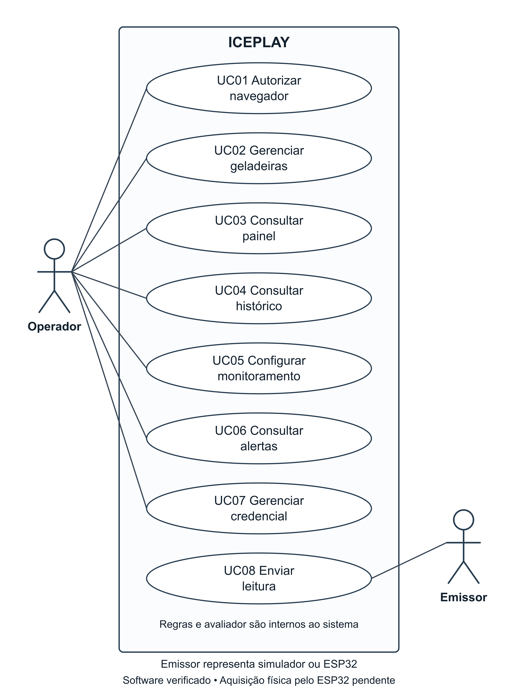
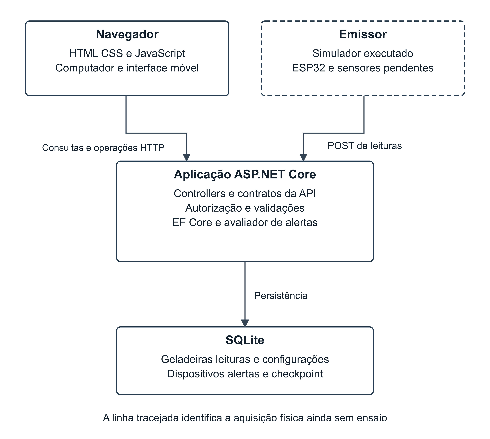
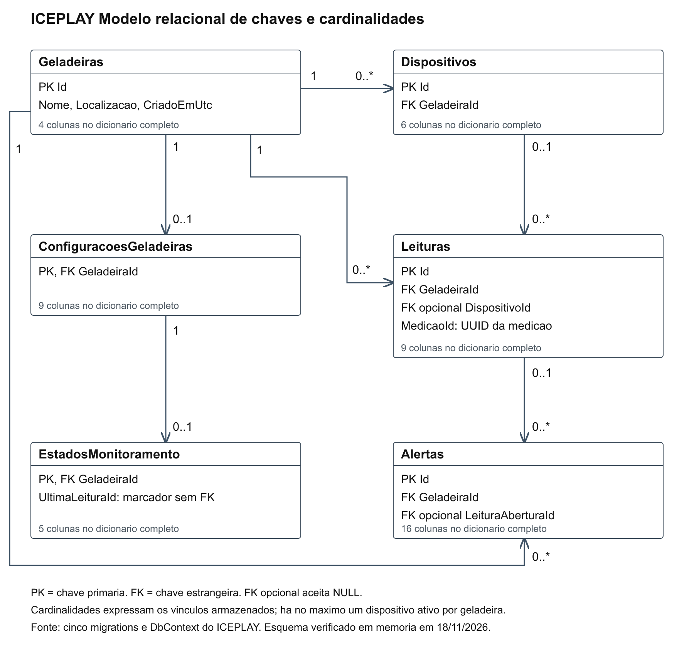
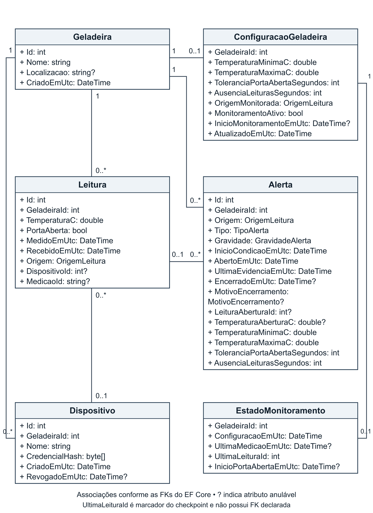
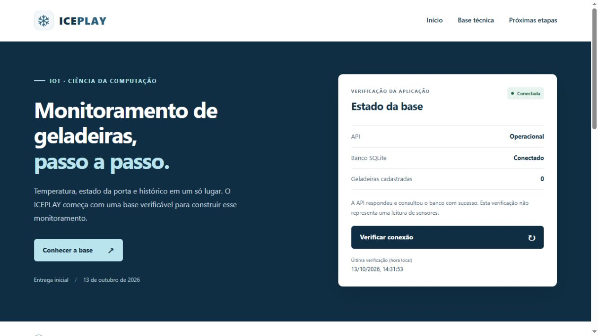
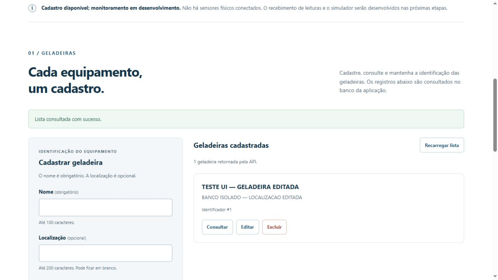
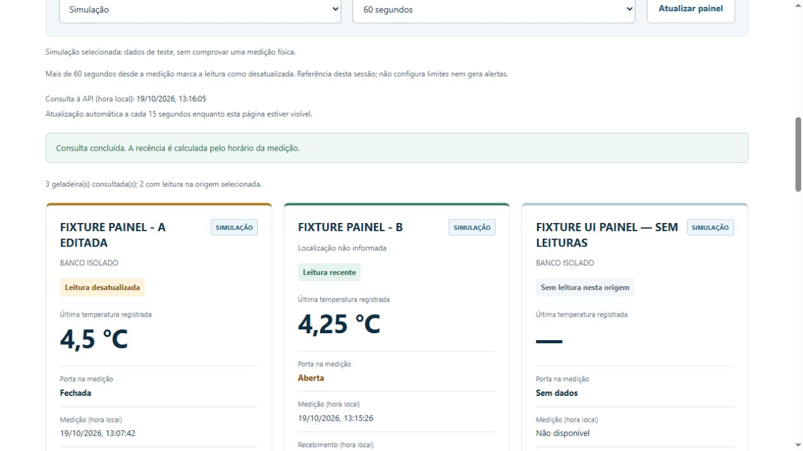
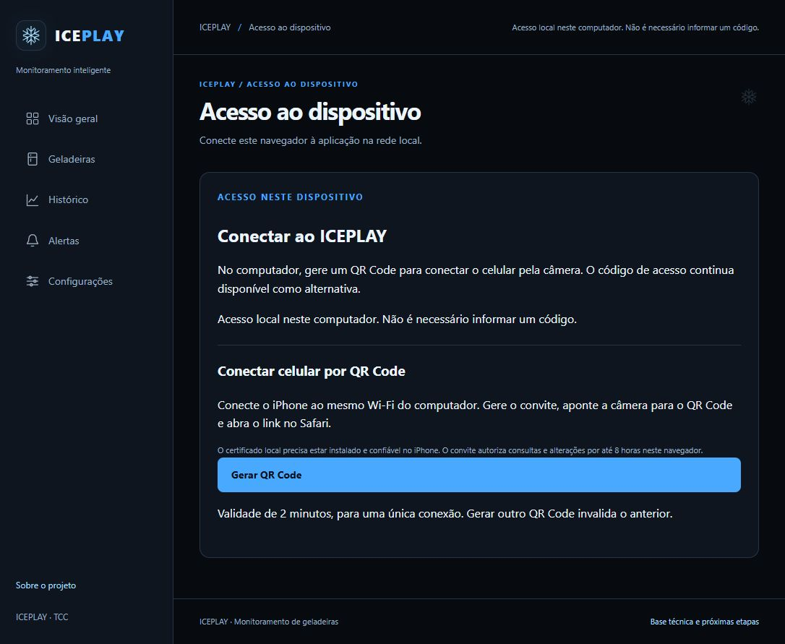
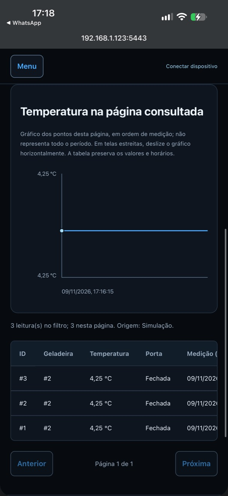

# ICEPLAY Sistema IoT para monitoramento de geladeiras comerciais

**Minuta histórica de 23/11/2026.** A versão Word/PDF privada atual incorpora os ensaios posteriores e o aviso sonoro de 26/11. Consulte a [revisão atual e evidências](../etapa-som-auditoria-2026-11-26.md); os trechos abaixo preservam o estado desta minuta e não substituem a entrega final.

Universidade Paulista UNIP

Curso de Ciência da Computação

Autor {{AUTOR}}

RA {{RA_PRIVADO}}

Orientador {{ORIENTADOR}}

Campus {{CAMPUS}}

{{ANO}}

**Minuta para revisão acadêmica.** Este texto registra software executado, firmware principal compilado e resultados parciais de bancada com diagnósticos isolados, atualizados na noite de 23/11/2026. A integração na geladeira e a conclusão definitiva dependem dos ensaios restantes. Não representa aprovação da banca ou conformidade de paginação Word.

O [complemento de modelagem e validação de 17/11/2026](materiais-modelagem-2026-11-17/README.md) fornece requisitos, casos de uso, classes, imagens, tabelas e resultados de uma nova execução dos verificadores para inserir e revisar nos capítulos de Projeto e Desenvolvimento. Ele atualiza essas evidências sem atribuir aquisição física aos testes de software.

## Resumo provisório

Este trabalho apresenta o desenvolvimento do ICEPLAY, um protótipo de monitoramento de geladeiras comerciais com interface web responsiva. O sistema registra temperatura e estado da porta, identifica a origem das amostras e armazena separadamente os instantes de medição e recebimento. A solução emprega ASP.NET Core, Entity Framework Core, SQLite e frontend em HTML, CSS e JavaScript, reunidos em uma aplicação local. Foram implementados cadastro de equipamentos, histórico paginado, painel, configurações por geladeira, episódios de alertas e credenciais para ingestão de dispositivos. O desenvolvimento utiliza verificação incremental de contratos HTTP, restrições de persistência, reinício e regras temporais. Um simulador envia amostras identificadas à mesma API destinada ao equipamento físico. O firmware principal para ESP32 foi compilado. Diagnósticos isolados comprovaram resposta elétrica básica do contato magnético e oito aquisições reais de temperatura pela USB; a integração física com a API e a geladeira permanece pendente. Os resultados demonstram os comportamentos de software exercitados e a aquisição de bancada registrada. Não permitem concluir precisão térmica, disponibilidade em campo ou redução de perdas. A etapa física possui protocolo próprio para registrar condições, falhas e evidências antes da conclusão final.

Palavras chave Internet das Coisas; monitoramento; refrigeração; API; sistemas embarcados.

## Abstract provisional version

This work presents ICEPLAY, a prototype for monitoring commercial refrigerators through a responsive web interface. The system records temperature and door state, identifies sample provenance, and stores measurement and reception timestamps separately. The implementation uses ASP.NET Core, Entity Framework Core, SQLite, and a static HTML, CSS, and JavaScript frontend within a local application. Implemented features include equipment management, paginated history, a dashboard, per refrigerator settings, alert episodes, and device credentials. Development follows incremental verification of HTTP contracts, persistence constraints, restarts, and time dependent rules. A simulator submits explicitly labelled samples to the same API intended for the physical device. The main ESP32 firmware has been compiled. Separate diagnostics demonstrated the basic electrical response of the magnetic contact and eight real temperature acquisitions over USB; physical integration with the API and refrigerator remains pending. Available results demonstrate the software behaviours exercised and the documented bench acquisition. They do not establish thermal accuracy, field availability, or reduction of losses. A separate physical test protocol defines the conditions, failures, and evidence to record before the final conclusions are completed.

Keywords Internet of Things; monitoring; refrigeration; API; embedded systems.

## Lista de abreviaturas e siglas

| Sigla | Significado |
| --- | --- |
| API | Application Programming Interface |
| CA | Certificate Authority, autoridade certificadora |
| CRUD | Create, Read, Update and Delete |
| CSRF | Cross-Site Request Forgery |
| DOM | Document Object Model |
| EF Core | Entity Framework Core |
| GPIO | General Purpose Input/Output |
| HTTP | Hypertext Transfer Protocol |
| HTTPS | Hypertext Transfer Protocol Secure |
| IoT | Internet of Things, Internet das Coisas |
| JSON | JavaScript Object Notation |
| MVP | Minimum Viable Product |
| RAM | Random Access Memory |
| REST | Representational State Transfer |
| RF | Requisito funcional |
| RNF | Requisito não funcional |
| SNTP | Simple Network Time Protocol |
| SQL | Structured Query Language |
| TLS | Transport Layer Security |
| UML | Unified Modeling Language |
| USB | Universal Serial Bus |
| UTC | Coordinated Universal Time |
| UUID | Universally Unique Identifier |

## 1 Introdução

O acompanhamento de uma geladeira exige interpretar valores de temperatura em conjunto com o momento de aquisição, a posição da sonda e o estado observado da porta. Um valor isolado pode permanecer na tela mesmo quando o emissor deixa de transmitir. A apresentação precisa distinguir informação recente, amostra atrasada e ausência de dados, para apoiar a consulta sem atribuir ao sistema observações que não foram realizadas.

O ICEPLAY foi definido como um protótipo acadêmico que reúne aquisição prevista por sensores, comunicação HTTP, persistência e consulta pelo celular. O cenário de implantação considera um computador executando a aplicação e dispositivos na mesma rede local. O projeto não parte de uma pesquisa realizada em estabelecimento específico nem de uma medição demonstrada de perdas comerciais. Seu resultado inicial é um artefato de software verificável, seguido de validação física documentada.

### 1.1 Problema de pesquisa e desenvolvimento

Como implementar e verificar um sistema de monitoramento de geladeiras que preserve a origem e os instantes das leituras, permita consulta pelo celular e registre ocorrências de temperatura, porta e ausência, mantendo a distinção entre simulação, emissor autenticado e sensor fisicamente validado?

Essa pergunta exige mais que receber um número. A aplicação precisa validar entradas, manter relacionamentos, sobreviver a reinícios, limitar o acesso do dispositivo e evitar que repetições ou atrasos criem uma situação operacional fictícia. A validação física também deve examinar o percurso completo, e não apenas observar um LED ou uma resposta serial.

### 1.2 Objetivos

O objetivo geral é desenvolver e validar o protótipo ICEPLAY para monitoramento de temperatura e estado da porta de uma geladeira, com persistência e interface web acessível pelo celular.

Os objetivos específicos são:

1. Cadastrar equipamentos e manter registros persistentes com integridade referencial.
2. Definir e verificar contrato de ingestão com origem e dois instantes UTC.
3. Disponibilizar painel e histórico com filtros, tabela, gráfico e paginação.
4. Persistir parâmetros por equipamento e avaliar regras/episódios de alerta sem duplicação.
5. Autorizar o emissor vinculado e permitir repetição segura de uma medição identificada.
6. Preparar firmware, montagem e ensaio real com ESP32, DS18B20 e contato magnético.
7. Registrar testes, decisões, limitações e assistência de IA de forma rastreável.

### 1.3 Justificativa e delimitação

O projeto integra conteúdos de desenvolvimento web, bancos de dados, sistemas embarcados, comunicação e testes. A escolha de um serviço local e frontend estático permite concentrar a implementação no fluxo dos dados e nas regras. O acesso pelo Safari atende à consulta no iPhone sem exigir aplicativo nativo.

O escopo é monitoramento e gestão de parâmetros. Não inclui acionamento elétrico do compressor, diagnóstico de segurança alimentar, notificações externas, nuvem pública ou aplicação multiusuário. Voz foi retirada do MVP por decisão de escopo. Os limites operacionais serão definidos conforme a geladeira e o uso, com o orientador; valores de teste não são recomendações sanitárias.

### 1.4 Método e organização

O trabalho utiliza desenvolvimento aplicado de protótipo, com leitura bibliográfica de apoio, especificação, modelagem e validação incremental. Cada incremento acrescenta um conjunto delimitado, executa verificadores e registra resultados no Git. Ensaios de software usam bancos isolados e amostras de simulação identificadas. O método e os resultados da integração física são tratados na seção 4.5.

As seções seguintes apresentam fundamentos, projeto, implementação e resultados disponíveis. As entregas institucionais informadas são versão completa em 24/11/2026 e apresentação em 01/12/2026.

## 2 Fundamentação e trabalhos relacionados

### 2.1 Sensoriamento conectado

Gubbi et al. (2013) discutem a ligação entre sensores conectados e compartilhamento de informação em IoT. No ICEPLAY, isso é organizado em aquisição, transporte, persistência e apresentação. A arquitetura local escolhida não reproduz a infraestrutura de nuvem discutida naquele trabalho; atende ao alcance definido para o protótipo.

Badia-Melis et al. (2018) apresentam tecnologias e limitações de monitoramento em cadeias frias, destacando que sua adequação depende da aplicação. O ICEPLAY recorta esse contexto para uma geladeira e dois sinais, sem afirmar cobertura de toda uma cadeia logística ou representar a temperatura de todos os produtos armazenados.

Esses textos servem de fundamentação inicial, não de comparação experimental entre produtos. A seleção, os metadados e o escopo de leitura consultado estão registrados nas referências. A revisão bibliográfica deve ser discutida com o orientador antes da versão final.

### 2.2 Dado medido e contexto temporal

Um instante de aquisição informado pelo emissor e um instante de chegada produzido pela API possuem responsabilidades diferentes. Separá-los permite observar atraso de transmissão. A API não corrige silenciosamente uma medição futura: recusa o pedido e preserva a necessidade de verificar os relógios.

Também é necessário distinguir ausência de dados de uma condição normal. Uma porta registrada como fechada anteriormente não garante que continua fechada durante uma interrupção. Por isso, a interface apresenta idade/origem, e o motor interrompe a sequência de porta diante de uma lacuna definida. Essa decisão é parte da interpretação do protótipo, cuja resolução temporal deve ser discutida no ensaio físico.

### 2.3 Persistência e comunicação

As entidades representam os registros do domínio; os contratos HTTP limitam o que o cliente pode determinar. Chaves estrangeiras preservam vínculos e impedem remover histórico por exclusão de equipamento. Migrations registram a evolução do esquema, permitindo verificar preservação por comparação de campos e identificadores.

HTTP é utilizado para operações de cadastro, ingestão e consulta. Códigos diferentes permitem distinguir entrada inválida, recurso inexistente, conflito e indisponibilidade. A idempotência da medição autenticada é uma regra explícita: o UUID identifica o evento de aquisição e seu reenvio não deve criar outro evento.

### 2.4 Segurança e limites da identidade

No modo móvel, o operador usa HTTPS, sessão e proteção CSRF. O dispositivo usa outro mecanismo, com segredo aleatório vinculado a uma geladeira e escopo de envio. O banco mantém somente hash desse segredo, e a emissão o exibe uma única vez. Jones e Hardt (2012) fundamentam os cuidados com o transporte e a posse de tokens Bearer; a autorização implementada pelo ICEPLAY é específica para o emissor, sem servidor de autorização de terceiros.

Autenticar o emissor não confirma que ele leu um sensor real nem que a medição é exata. A evidência física exige identificar montagem, condições e resultado observado. A configuração da placa contém segredo e pertence ao ambiente privado, assim como o banco de uso e os backups.

### 2.5 Soluções de mercado e contribuição do projeto

O monitoramento conectado de refrigeração já possui soluções comerciais. O Sitrad Pro, da Full Gauge Controls, documenta integração com instrumentos, visualização, alarmes, relatórios e acesso móvel. O testo Saveris 2 utiliza registradores Wi-Fi e a nuvem do fabricante para armazenar e consultar dados; seu manual descreve alarmes e recursos condicionados ao plano contratado (Full Gauge Controls, [s. d.]; Testo, [s. d.]).

Quadro 1 - Comparação documental de soluções de monitoramento

| Critério | ICEPLAY | Sitrad Pro | testo Saveris 2 |
| --- | --- | --- | --- |
| Armazenamento e execução | API e SQLite no computador de execução | Servidor e instrumentos compatíveis do fabricante | Registradores Wi-Fi e Testo Cloud |
| Consulta | Navegador responsivo, painel e histórico paginado | Visualização e acesso móvel documentados | Consulta de dados pela nuvem em dispositivos conectados |
| Ocorrências | Episódios de temperatura, porta e ausência na aplicação | Alarmes e relatórios documentados | Alarmes por limites e avisos; funções dependem da licença |
| Notificações externas | Não integram o MVP atual | Configuração de envio de e-mail documentada | E-mail e funções adicionais conforme o plano |
| Escopo desta análise | Implementação e verificadores do protótipo | Leitura de documentação oficial | Leitura do manual oficial, versão 2.12 |

Fonte: código e verificadores do ICEPLAY; Full Gauge Controls ([s. d.]); Testo ([s. d.]). Consulta documental em 18 nov. 2026, sem ensaio comparativo dos produtos.

A comparação identifica sobreposição funcional e diferenças de implantação, sem demonstrar superioridade, menor custo total ou ineditismo. A contribuição do ICEPLAY é aplicada e acadêmica: integrar API, persistência, interface e avaliação temporal em uma implementação inspecionável, com origem declarada, dois timestamps, reenvio idempotente e verificações reproduzíveis. Não foi realizada pesquisa de patentes ou revisão sistemática que permita reivindicar uma tecnologia inédita.

## 3 Projeto do sistema

### 3.1 Requisitos e regras

Os requisitos funcionais RF01–RF13 preservam a organização inicial: saúde, interface, equipamentos, ingestão, timestamps, origem, histórico, painel, regras, ausência, episódios, simulador e integração física. Configurações, credencial/idempotência e acesso móvel foram explicitados como RF14–RF16. Os requisitos não funcionais RNF e a matriz de rastreabilidade associam qualidades, implementação, verificador e situação. A Figura 1 apresenta os papéis externos e os oito casos de uso.

Figura 1 - Casos de uso do ICEPLAY

Fonte: modelagem do projeto, preparada com assistência de IA em 17 nov. 2026 a partir dos requisitos e do código. Diagrama de projeto, não captura de execução.

As regras centrais incluem temperatura fora de limites inclusivos, duração de porta confirmada por medições e ausência avaliada periodicamente. A idade da medição foi escolhida para ausência, evitando que upload antigo renove a informação. Limites/tempos são obrigatórios em configuração e não são presumidos. A origem monitorada é única por equipamento nesta versão.

Um episódio permanece aberto durante evidências da mesma condição. Recuperação permite novo episódio posterior. Encerramentos por normalização, ausência de dados, alteração de configuração e desativação são distintos. Assim, desativar não equivale a demonstrar uma temperatura normal. A gravidade é classificação de software do protótipo, sem validade sanitária presumida.

### 3.2 Arquitetura

Uma aplicação ASP.NET Core hospeda API e arquivos estáticos. Controllers recebem contratos validados; o DbContext acessa o SQLite. O avaliador de alertas roda no mesmo processo, a cada segundo. O navegador consulta a API e não acessa o arquivo de banco. Simulador e firmware compartilham a rota de ingestão, com origens e autorização apropriadas.

O serviço periódico utiliza a estrutura de serviços hospedados descrita pela Microsoft ([s. d.]); os critérios de temperatura, porta e ausência foram definidos e verificados no próprio projeto.

Essa organização evita serviços externos desnecessários ao MVP e torna a execução local reproduzível. Existe uma instância e um banco de arquivo. Migrations automáticas são limitadas a Development; outro ambiente exige aplicação explícita. O desenho não promete implantação distribuída ou alta disponibilidade.

A Figura 2 apresenta a comunicação entre navegador, emissores, aplicação e banco. O avaliador de alertas é interno ao backend, separado logicamente da recepção das leituras. A aquisição física prevista aparece delimitada no modelo.

Figura 2 - Arquitetura e comunicação do ICEPLAY

Fonte: código do ICEPLAY e modelagem assistida por IA, 17 nov. 2026.

### 3.3 Modelo de dados

| Entidade | Responsabilidade |
| --- | --- |
| Geladeira | Identidade, nome, localização e criação |
| Leitura | Temperatura, porta, origem, dois instantes e vínculo opcional de emissor/UUID |
| ConfiguracaoGeladeira | Faixa, tempos, origem, ativação e instantes de acompanhamento |
| Alerta | Episódio, gravidade, evidências, encerramento/motivo e cópia dos parâmetros |
| EstadoMonitoramento | Checkpoint e sequência de porta persistidos |
| Dispositivo | Vínculo, nome, hash da credencial, criação e revogação |

O registro de leituras e alertas restringe a exclusão do equipamento. A configuração é única por geladeira. Índices únicos parciais protegem episódio aberto, dispositivo ativo e medição identificada. Campos novos de emissor são anuláveis para preservar registros anteriores. As cinco migrations e o SQL para banco novo estão versionados; não se recria o banco para corrigir uma atualização.

A Figura 3 apresenta uma visão relacional de chaves e cardinalidades. O esquema das cinco migrations foi executado em SQLite em memória e conferido: seis tabelas de domínio, 49 colunas e sete chaves estrangeiras. `UltimaLeituraId` é marcador do avaliador, sem FK declarada. Há histórico de dispositivos por geladeira, com no máximo um ativo por índice parcial; por isso, a cardinalidade histórica é de zero a muitos. O dicionário completo acompanha a figura em `revisao-orientador-2026-11-18/esquema-relacional.json`.

Figura 3 - Modelo relacional de chaves e cardinalidades

Fonte: SQL das migrations e IceplayDbContext; esquema conferido em memória e diagrama elaborado com assistência de IA em 18 nov. 2026. A figura resume as chaves; as demais colunas estão no dicionário.

### 3.4 Contratos e interface

As famílias de rotas da API REST abrangem saúde, geladeiras, configuração, leituras, monitoramento, alertas, dispositivos e acesso. Os contratos documentam JSON, regras, instantes e respostas. O dispositivo recebe apenas permissão de POST de sua geladeira; não utiliza a sessão do operador.

Visão geral, Geladeiras, Histórico, Alertas e Configurações possuem HTML/URL próprios. Acesso e Sobre são páginas auxiliares. O menu adapta-se ao celular e a identidade Black & Ice Blue é compartilhada. O gráfico usa somente os pontos da página; a tabela mantém valores e horários. Erros não deixam uma lista anterior como se fosse consulta atual confirmada.

### 3.5 Modelagem e critérios de aceite

A modelagem UML inclui casos de uso, classes, componentes, sequência e estados. A Figura 4 apresenta as classes, nulabilidade e associações mapeadas pelo EF Core. A matriz relaciona os critérios de aceite aos verificadores e ao protocolo de integração descrito na seção 4.5.

Figura 4 - Classes e associações da persistência

Fonte: Models e IceplayDbContext do ICEPLAY; modelo preparado com assistência de IA em 17 nov. 2026.

## 4 Desenvolvimento e resultados disponíveis

### 4.1 Implementação incremental

O repositório preserva etapas documentadas de base, cadastro, leituras, painel, histórico, páginas, configurações, alertas, autenticação e firmware. O histórico Git foi iniciado efetivamente em 30/10; não foram criados commits retroativos para atividades anteriores. Em 12/11, os incrementos de alertas, interface e dispositivo foram testados/publicados separadamente; o firmware foi compilado e seu relatório fechado em 13/11.

O build usa SDK .NET 10.0.401 e pacotes EF Core 10.0.12 fixados. As verificações HTTP criam SQLite isolado e exercitam entradas válidas/inválidas, inexistência, restrições, falha de banco e persistência. Regras temporais possuem programa C# com relógio controlado; a API não expõe rota para mudar o tempo. Os testes Node executam lógica e clientes com Document Object Model (DOM), representação da página em objetos, e respostas de rede controladas. Isso permite verificar o comportamento do cliente, enquanto a renderização no navegador é uma verificação separada.

### 4.2 Resultados de software

Nova rodada de software executada em 18/11/2026, entre 22:02:05 e 22:05:06 UTC, na revisão `bc89543`. Os resultados constam na Tabela 1. Os registros anteriores permanecem preservados em seus relatórios datados.

Tabela 1 - Resultados da rodada de software de 18 de novembro de 2026

| Conjunto executado | Resultado registrado |
| --- | --- |
| Build .NET | Sucesso, zero avisos e erros |
| Base e saúde | 13 verificações |
| CRUD | 807 verificações e 177 requisições registradas |
| Leituras | 339 e 75 |
| Histórico | 145 e 68 |
| Painel | 70 e 29, além do simulador |
| Configurações | 153 e 67, além de dois PUTs concorrentes |
| Alertas | 31 verificações com relógio controlado; HTTP 92 e 68 |
| Dispositivo | 85 e 56, incluindo configuração, ingestão autenticada e consulta de alerta/painel |
| Rede móvel | 181 e 137, com TLS e cliente de dispositivo sem cookie |
| Convites temporários | 13 verificações com relógio controlado |
| Páginas | 216 e 52 |
| JavaScript | 149 testes passaram, zero falhas |

Fonte: logs e JSONs em `docs/evidencias/20261118T220205Z-revisao-orientador/`; contagens referem-se a verificações e requisições, respectivamente, quando há dois números.

Essas contagens são verificações dos programas e não porcentagem de cobertura ou quantidade de funcionalidades independentes. Rodadas interrompidas foram preservadas e corrigidas/repetidas; os relatórios explicam diferenças de esquema, ajustes do coletor e limites. Os caminhos completos de evidência estão nos relatórios de etapa do repositório.

As Figuras 5 a 8 documentam a evolução visual do sistema. São capturas preservadas, com suas próprias datas; não foram produzidas novamente para representar uma aula anterior. Na revisão de 18/11, a API também foi executada com seis leituras Simulacao em banco isolado e a Visão geral foi observada por acessibilidade no Chrome. A tentativa de nova captura gráfica retornou erro da ferramenta, sem produzir imagens; o registro está em `interface/estado-api.json` na pasta da nova rodada.

Figura 5 - Tela inicial com verificação de API e SQLite

Fonte: captura preservada da etapa de 13 out. 2026, associada ao relatório original do navegador; primeiro versionamento em 30 out. 2026.

Figura 6 - Cadastro e edição em banco isolado

Fonte: captura e relatório de 15 out. 2026. O cadastro visível é fixture identificada de teste de software.

Figura 7 - Painel com temperatura e porta de origem Simulacao

Fonte: captura e relatório de 19 out. 2026, em banco isolado. Os valores apresentados foram produzidos pelo simulador.

Figura 8 - Identidade Black e Ice Blue e navegação por páginas

Fonte: captura preservada de 14 nov. 2026, sem convite QR ativo. A tela antecede a correção posterior do leitor interno.

No banco de uso, a atualização para cinco migrations preservou uma geladeira e três leituras Simulacao, com hash dos campos históricos igual nos backups anteriores/posteriores. Não foram inseridos parâmetros, credenciais ou medições físicas automaticamente. A aplicação foi executada com consulta real de saúde e rotas, mantendo HTTPS e exigência de sessão na rede.

### 4.3 Firmware preparado

O firmware usa ESP32 clássico, DS18B20 e contato magnético, com GPIOs lógicos documentados. A amostragem nominal é 10 segundos, há debounce e conversão não bloqueante. A conexão utiliza WiFi, SNTP, validação de CA e UUID no reenvio. O buffer conserva uma amostra em RAM por até 30 segundos; não promete histórico offline completo.

As especificações de componente foram consultadas em Analog Devices (2019) e Espressif Systems ([s. d.]); a identificação do alvo de compilação segue a documentação do PlatformIO ([s. d.]). Esses documentos orientam a preparação e não substituem os resultados de bancada.

Foram compilados o exemplo desabilitado e uma cópia isolada com configuração sintética habilitada. O perfil configurado apresentou 47708 bytes de RAM estática e 929469 bytes de aplicação flash segundo o compilador. Houve dois avisos na biblioteca OneWire, sem falha de compilação. Esses números são resultados do compilador, sem medição de consumo dinâmico. A bancada posterior utilizou um programa de diagnóstico separado, conforme a seção 4.5.

### 4.4 Acesso pelo iPhone

Em 09/11, o aluno confirmou uso parcial no iPhone, e foto posterior mostrou tabela/gráfico com três leituras de simulação. Essa confirmação é distinta dos testes HTTP e das novas telas. Alertas, configuração, credenciais, orientação/teclado e o leitor QR implementado posteriormente ainda precisam de conferência visual no aparelho. O registro manual identifica o que foi relatado e o que apareceu na fotografia, sem generalizar a aprovação para versões posteriores.

A Figura 9 reproduz a fotografia do histórico fornecida pelo aluno. O gráfico e a tabela apresentam três leituras de 4,25 °C, porta fechada e origem Simulação.

Figura 9 - Histórico de simulação apresentado no iPhone

Fonte: fotografia de tela cedida pelo aluno e associada ao registro de acompanhamento de 9 nov. 2026, copiada sem alteração de bytes. Não representa medição de sensor físico nem teste do leitor QR posterior.

### 4.5 Validação de bancada e limitações da integração

Em 16/11, o Windows reconheceu o ESP32 DEVKITV1 com CP2102 na COM3 após instalação autorizada do driver. Em 18/11, a consulta serial identificou ESP32-D0WD-V3, revisão 3.1, cristal de 40 MHz e flash de 4 MB. Com autorização do aluno, foi gravado um diagnóstico temporário de GPIO27. Foram capturados oito níveis HIGH sem conexões, oito LOW com ponte de jumper e oito HIGH após retirar a ponte, em três capturas separadas por reinício. Esses resultados validam comunicação serial e os estados da entrada elétrica testada.

Na noite de 23/11, o contato SP-1006 com ímã produziu HIGH/LOW/HIGH/LOW/HIGH em cinco capturas separadas por reinício, com 8/8/8/7/8 registros. A resposta básica foi repetida; não foram medidas transição contínua, latência, alcance ou debounce. Depois da montagem DS18B20/4k7 confirmada verbalmente pelo aluno, um novo diagnóstico de temperatura e porta foi gravado com autorização específica. Em 24/11 às 01:04:49–01:05:05 UTC, ainda 23/11 às 22:04:49–22:05:05 em São Paulo, foram recebidas oito temperaturas de 24,4375 °C pela USB, com banner e sem mensagens de erro. Os 16 registros GPIO27 foram HIGH, sem posição de ímã definida para essa captura. O [relatório da aquisição](../etapa-leitura-temperatura-2026-11-23.md) vincula dados, horários e hashes; quatro casas decimais não representam precisão experimental.

A placa executa o diagnóstico isolado dos sensores; o firmware principal de ingestão ainda não foi gravado. Resposta à variação térmica, desconexão da sonda, instalação e percurso de envio físico à API, persistência, interface e regras na geladeira continuam pendentes. Essa integração pertence ao objetivo do TCC, e não foi reclassificada como simples trabalho futuro. O protocolo F01–F12 orienta o registro de montagem, parâmetros, período, interrupções, recuperação, observado e resultado, incluindo falhas/retestes. F01, F02 e F03 permanecem parciais.

Se houver comparação térmica, identificar o instrumento e seu estado de calibração conhecido, sincronização e condições. Sem referência apropriada não declarar calibração nem erro máximo experimental. Discussão deve considerar amostragem, polling atrasado durante HTTP, buffer limitado, falhas de energia/rede e período em que a API não estava executando. Não extrapolar observações de uma geladeira para uso comercial geral.

### 4.6 Assistência de IA e rastreabilidade

Ferramentas de IA auxiliaram análise, implementação, testes e redação, conforme registro em `docs/uso-de-ia.md`. Não se atribui ao aluno histórico de escrita manual inexistente. Cabe ao autor revisar código/texto, reproduzir os comandos, verificar as referências e explicar decisões/limitações na defesa. Logs de teste e simulação não serão apresentados como medições de sensores.

## 5 Conclusão

Este trabalho apresentou o desenvolvimento do ICEPLAY, um protótipo voltado ao monitoramento de geladeiras comerciais. O núcleo de software foi implementado com interface web responsiva, API em ASP.NET Core, persistência em SQLite e avaliação de regras temporais. O firmware principal para ESP32 foi preparado e compilado, mantendo o contrato destinado à integração dos sensores.

Na rodada de 18/11/2026, o build terminou sem avisos ou erros, os 149 testes JavaScript passaram e os dez verificadores de software foram concluídos sem falha. Os cenários exercitaram persistência, validação HTTP, separação de origens, reenvio idempotente autenticado e abertura/encerramento de episódios de temperatura, porta e ausência de leituras. Esses resultados sustentam os comportamentos verificados no ambiente de teste, sem constituir garantia geral de confiabilidade, precisão térmica ou disponibilidade em campo.

Entre os desafios de implementação estiveram a interpretação de medições atrasadas, a continuidade das regras temporais e a preservação de integridade e rastreabilidade. A contribuição é uma integração acadêmica inspecionável e reproduzível desses componentes. A análise documental de Sitrad Pro e testo Saveris 2 mostra que monitoramento e alertas já existem no mercado; não foi demonstrado ineditismo ou superioridade comercial do ICEPLAY.

Na integração física, foram comprovados reconhecimento USB, comunicação serial, resposta elétrica básica do contato magnético e oito aquisições de temperatura pelo DS18B20 em diagnóstico isolado pela USB. A resposta térmica, o comportamento em falha e o ensaio de ponta a ponta na geladeira ainda são necessários para concluir o objetivo geral do projeto. Permanecem também a validação móvel complementar e o ensaio no computador da apresentação. Assim, os objetivos de implementação de software foram atendidos nos cenários descritos, enquanto a validação completa do protótipo permanece em andamento.

Após concluir essa etapa do TCC, a evolução pode incluir notificações por e-mail ou mensageria, exportação de relatórios operacionais, fila offline persistente e múltiplos operadores. Relatórios não devem ser apresentados como certificação de conformidade sanitária sem critérios e validação próprios. A versão final da conclusão deverá incorporar os resultados efetivos dos ensaios físicos e suas limitações.

## Referências

As entradas bibliográficas padronizadas estão em [referencias.md](referencias.md). A apresentação e a revisão das referências seguem o guia da Biblioteca da Universidade Paulista - UNIP (2025). Na montagem do Word completo, incluir somente as fontes efetivamente citadas, em ordem alfabética, e atualizar as chamadas no texto. Os registros internos de implementação são organizados nos apêndices técnicos, separados das fontes bibliográficas externas.

## Apêndice A Contrato de alertas

O [contrato de alertas do próprio projeto](../contrato-alertas.md) especifica parâmetros, regras, episódios, filtros, códigos HTTP e limites. É documentação técnica produzida no desenvolvimento; sua organização como apêndice não substitui a fundamentação bibliográfica.

## Apêndice B Requisitos modelagem e evidências

Reúnem-se a [rastreabilidade dos requisitos](../requisitos-rastreabilidade.md), o [dicionário relacional](revisao-orientador-2026-11-18/esquema-relacional.json), o [material de modelagem](materiais-modelagem-2026-11-17/README.md), a [rodada de software de 18/11](../evidencias/20261118T220205Z-revisao-orientador/rodada.json) e o [protocolo físico](../hardware/protocolo-ensaio.md). Na versão de entrega, ajustar a numeração dos apêndices e as referências cruzadas à organização da monografia completa.
