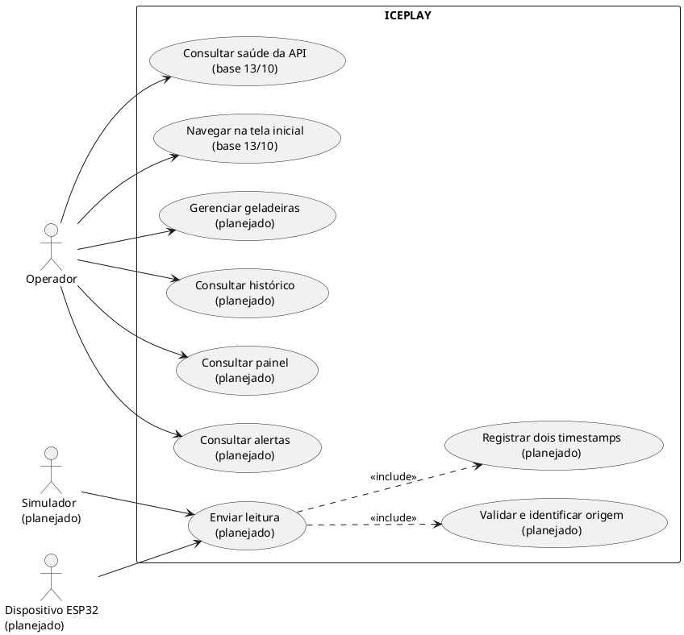
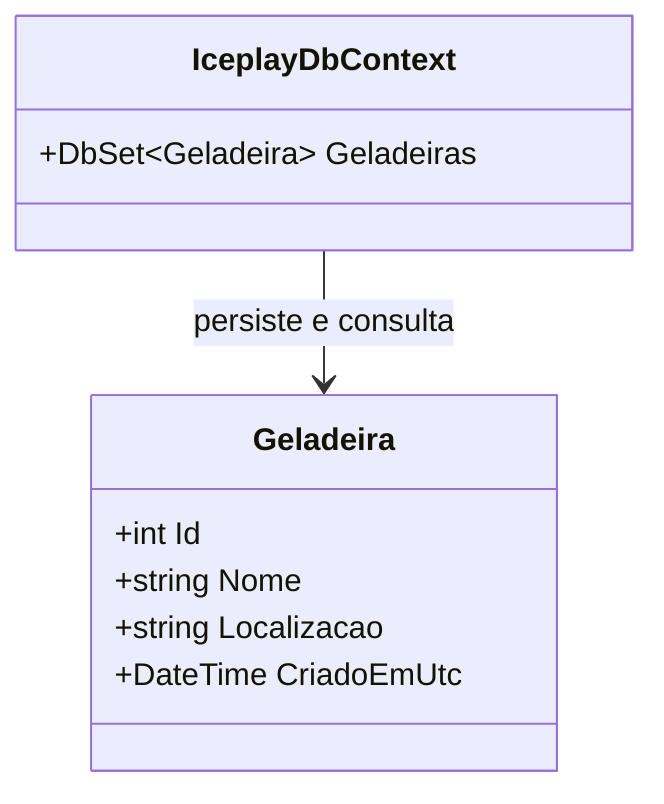
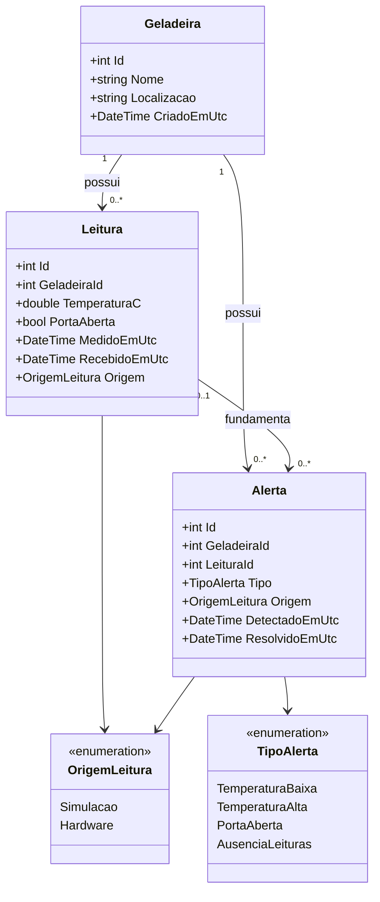
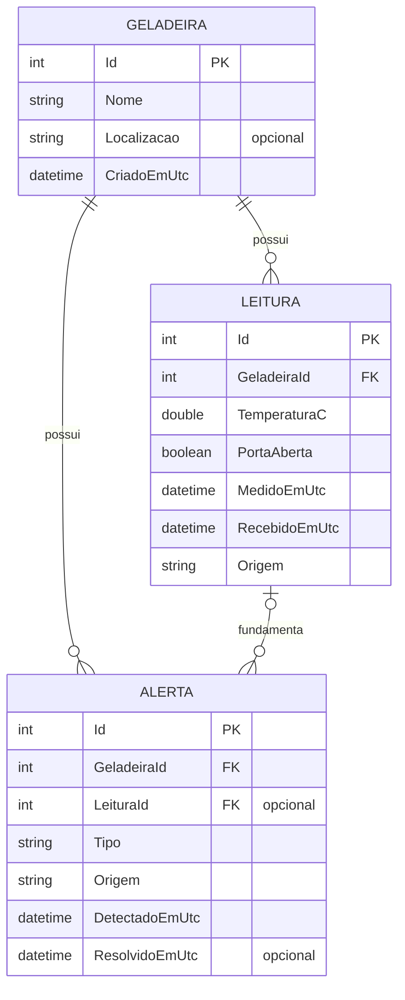
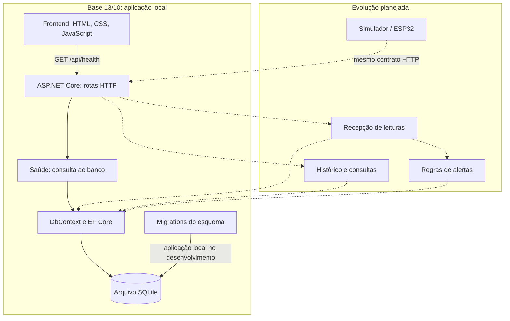
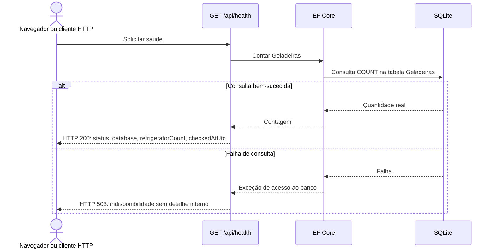
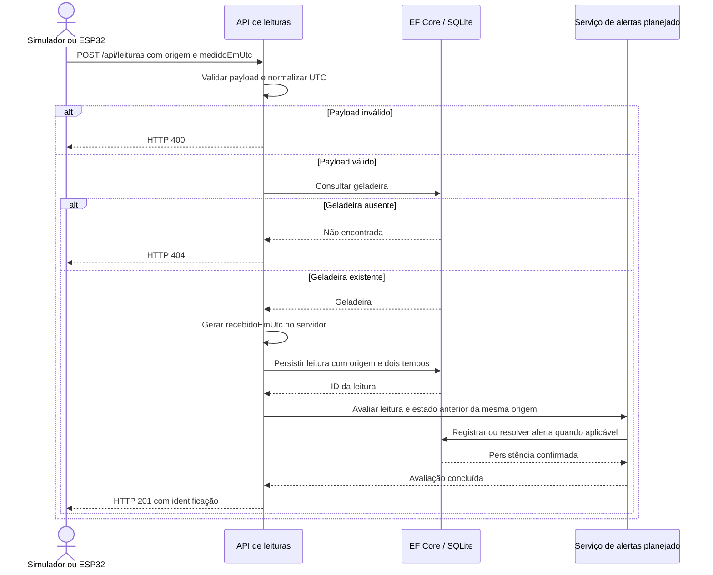
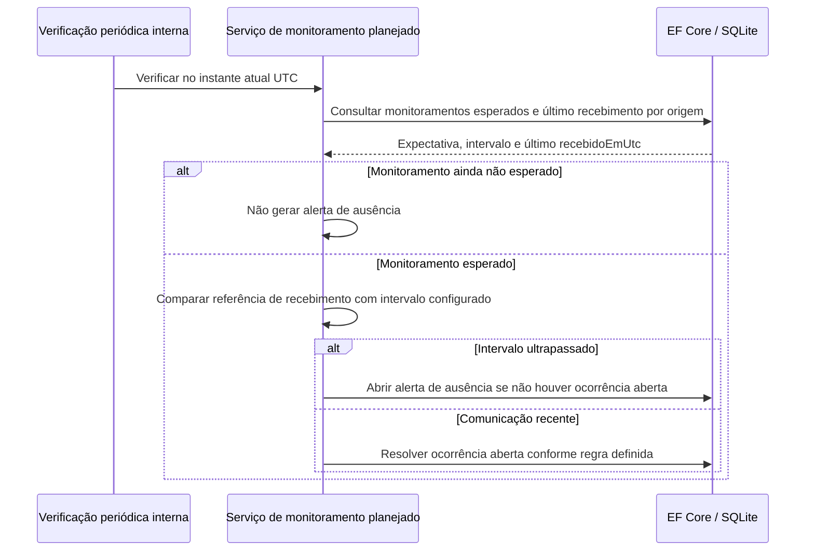
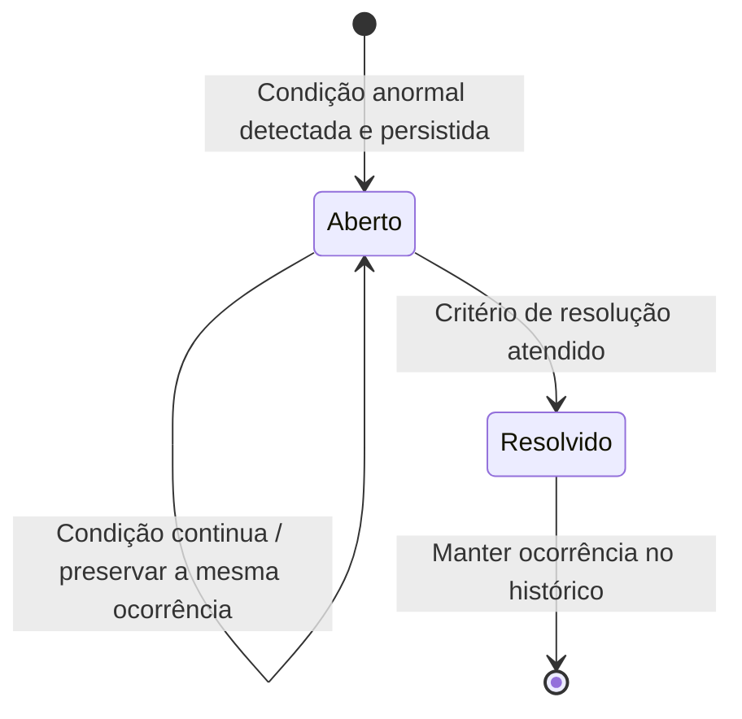
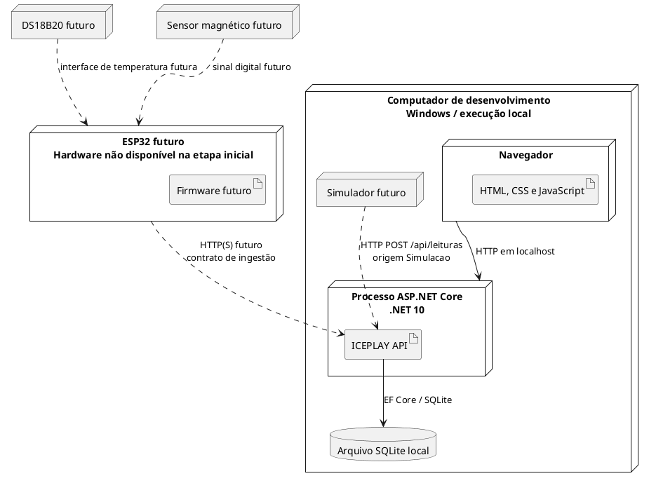

# ICEPLAY — fontes da modelagem UML

**Modelo atual de ingestão:** consulte [Contrato de leituras e modelo atual](contrato-leituras.md), com as classes e a sequência implementadas. Os diagramas abaixo foram preservados como registro histórico da base e da proposta de **13/10/2026**; seus elementos planejados não descrevem automaticamente o estado atual do código.

**Acesso móvel de 19/10:** a sequência da sessão HTTPS está em [Etapa móvel](etapa-mobile-2026-10-19.md). Essa autenticação temporária não acrescenta tabelas ao modelo de dados e não representa autenticação do ESP32.

Data de referência: **13/10/2026**.

Os diagramas distinguem a base da entrega inicial da evolução planejada. Somente saúde da API, modelo inicial `Geladeira`, SQLite e página inicial pertencem à primeira etapa. Os demais elementos descrevem o objetivo futuro e devem ser atualizados conforme forem implementados e testados. Estes diagramas não afirmam que houve ensaio com sensores físicos.

Mermaid pode ser visualizado em um leitor compatível. Os blocos PlantUML são fontes textuais para exportação futura; não foi instalado nem executado renderizador PlantUML. Renderização não é dependência do sistema.

## 1. Casos de uso — UML em PlantUML

O operador interage com o painel. Simulador e dispositivo enviam amostras pelo mesmo caso de uso de ingestão. Não há ator ESP32 em operação na primeira entrega.

Detecção automática de anomalias é comportamento interno do sistema, descrito nos diagramas de sequência e estados. Voz e notificações externas ficam fora deste modelo inicial.

## 2. Classes — base de 13/10

`Nome` é obrigatório e limitado a 100 caracteres. `Localizacao` é opcional e limitada a 200. `CriadoEmUtc` é gerado em UTC. O diagrama simplifica a assinatura de `Localizacao`; a implementação C# usa `string?`. A existência do modelo não implica a existência de endpoints de cadastro nesta etapa.

## 3. Classes de domínio — evolução planejada

`Alerta.LeituraId` e `Alerta.ResolvidoEmUtc` serão anuláveis. Alertas de ausência não precisam de leitura associada. Os tipos e campos futuros são propostas a confirmar na implementação. Limites e durações configuráveis deverão ser incorporados após definição da regra; ainda não há entidade ou contrato definitivo para essa configuração.

## 4. Modelo entidade-relacionamento — evolução planejada

Este diagrama complementa a UML e descreve as relações do armazenamento. Apenas `GELADEIRA` integra a migration inicial.

Nomes e tipos SQL concretos serão definidos pelo mapeamento EF e pelas migrations. O diagrama é conceitual. Exclusões que removam evidências históricas devem ser restringidas.

## 5. Componentes — representação em Mermaid

O fluxo é uma representação de responsabilidades; não exige processos ou projetos separados para cada caixa. O backend continua uma única aplicação.

## 6. Sequência — verificação de saúde da base

Banco vazio retorna contagem zero e pode estar saudável. O teste deve confirmar a resposta real; o desenho não é uma captura de execução.

## 7. Sequência — ingestão futura

É uma sequência de projeto. A garantia entre gravação da leitura e atualização dos alertas deverá ser definida na etapa das regras, incluindo transação e tratamento de falhas. Temperatura e porta não geram medições físicas quando o emissor é o simulador.

## 8. Sequência — ausência futura de leituras

Na ativação sem primeira leitura, uma referência inicial de monitoramento deverá existir para que a regra seja definida. Uma leitura simulada não satisfaz a expectativa de comunicação do hardware. Ausência gera um alerta, não uma leitura artificial.

## 9. Estados — ocorrência futura de alerta

Uma nova condição após resolução origina uma nova ocorrência. O critério de resolução será definido por tipo de alerta. O modelo proposto representa o estado por `ResolvidoEmUtc`: nulo para aberto e preenchido para resolvido. Não existe transição manual implementada na base.

## 10. Implantação — UML em PlantUML

A execução inicial é em localhost. Rede externa, autenticação e HTTPS devem ser definidos antes de conectar dispositivos fora do computador local. DS18B20, sensor magnético e ESP32 são implantação prevista, sem alegação de instalação ou ensaio físico.

## 11. Rastreabilidade e atualização

| Diagrama | Requisitos relacionados | Quando revisar |
| --- | --- | --- |
| Casos de uso | RF01–RF13 | A cada alteração de escopo aprovada |
| Classes da base | RF01 e futura RF03 | Após mudança de `Geladeira` ou contexto |
| Classes e ER futuros | RF04–RF11 | Antes e depois de migrations de leituras/alertas |
| Componentes e implantação | RNF01, RNF08–RNF10 | Quando mudar execução, rede ou dependência |
| Sequência de saúde | RF01 | Quando mudar o contrato ou o teste de saúde |
| Sequência de ingestão | RF04–RF06, RF12–RF13 | Ao implementar e validar a API de sensores |
| Sequência de ausência | RF10 | Ao definir e testar expectativa e intervalo |
| Estados de alertas | RF09–RF11 | Ao definir detecção, duplicação e resolução |

Os identificadores são os de [planejamento.md](planejamento.md). A entrega escrita final deve incluir versões de diagramas coerentes com o código e referências para evidências reais; fontes de diagramas planejados não devem ser usadas como resultado de testes.
